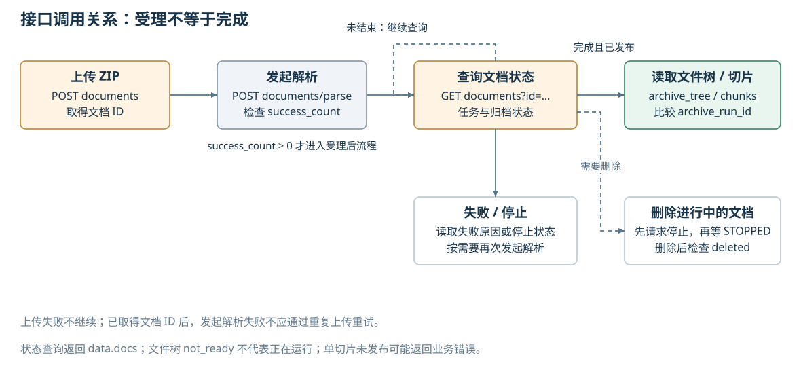

# ZIP 代码包导入与解析接口文档

RAGFlow Go 后端 · 接口对接说明 · 2026-11-19

本文说明 ZIP 上传、解析、状态查询、文件树、源码切片、检索及文档操作的 HTTP 接口。接口行为以 Go 后端实现为准；不展开页面实现、解析算法或数据库设计。**后端功能代码基准：`5030616ddf44418f65100c71ef64595a9d313a72`。** 管理侧交接前应核对实际部署的代码基准；部署代码变化后，应重新核对请求、响应与能力边界。

**先上传取得文档 ID，再发起异步解析；只有任务完成且归档结果已发布，才能读取本轮文件树和源码切片。**

## 1. 接口总览与通用约定 {#overview}

### 1.1 接口总览 {#endpoints}

以下路径均相对于 `/api/v1`。完整的路径参数、请求及响应见各接口章节。

| 接口名称 | 功能 | API | 类型 |
|---|---|---|---|
| 上传 ZIP | 保存原包并登记一条文档 | `POST /datasets/{dataset_id}/documents?type=local` | 改造 |
| 发起解析 | 首次解析，或失败 / 停止后重试 | `POST /datasets/{dataset_id}/documents/parse` | 沿用 |
| 查询文档 | 查询文档列表、任务状态和归档状态 | `GET /datasets/{dataset_id}/documents` | 改造 |
| 查询文件树 | 返回已发布的目录与文件相对路径 | `GET /datasets/{dataset_id}/documents/{document_id}/archive_tree` | 新增 |
| 查询切片列表 | 分页返回源码切片及来源 | `GET /datasets/{dataset_id}/documents/{document_id}/chunks` | 改造 |
| 查询单个切片 | 返回指定已发布切片的内容 | `GET /datasets/{dataset_id}/documents/{document_id}/chunks/{chunk_id}` | 改造 |
| 检索 | 按问题检索已发布代码片段 | `POST /retrieval` | 改造 |
| 停止解析 | 请求停止排队或执行中的任务 | `POST /datasets/{dataset_id}/documents/stop` | 沿用 |
| 清旧重解析 | 清除已有结果后重新解析同一文档 | `POST /datasets/{dataset_id}/chunks` | 沿用 |
| 更新文档 | 修改允许的配置、启用或禁用文档 | `PATCH /datasets/{dataset_id}/documents/{document_id}` | 改造 |
| 切片启停 | 启用或禁用指定切片 | `PATCH /datasets/{dataset_id}/documents/{document_id}/chunks` | 沿用 |
| 删除文档 | 删除 ZIP 文档及其结果 | `DELETE /datasets/{dataset_id}/documents` | 改造 |

“沿用”指请求与返回格式沿用原接口，执行过程仍包含 ZIP 的身份、发布和清理校验。除文件树外，不新增 ZIP 专用路由。



### 1.2 地址、鉴权与内容类型 {#conventions}

- **服务地址**：以部署提供的 RAGFlow API 地址为准，本文用 `<BASE_URL>` 表示，例如 `https://ragflow.example.com`。
- **鉴权**：服务间调用使用请求头 `Authorization: Bearer <API_KEY>`；同一租户 API 路由也支持有效的用户访问令牌。凭据须具备对应知识库和文档的读取、更新、运行或删除权限，检索需要知识库的使用权限。不要使用系统超级管理员身份替代租户业务身份。
- **JSON 请求**：使用 `Content-Type: application/json`。GET 请求的筛选项放 Query，不放 JSON body。
- **上传请求**：使用 `multipart/form-data`；使用 curl 或 HTTP 客户端时，由客户端生成 boundary，不手工设置固定 boundary。
- **作用域**：`document_id` 必须属于路径中的 `dataset_id`，`chunk_id` 必须属于指定文档。ID 作为不透明字符串使用，不按文件名构造。
- **前置条件**：ZIP 导入与解析仅支持 MySQL 元数据库 + Elasticsearch 文档引擎；知识库已存在，向量模型及语法、计数等运行依赖已配置。其他组合的受控 ZIP 上传、入队和执行返回 `ZIP_UNSUPPORTED_DEPLOYMENT`，不影响其普通文档能力。在支持 ZIP 的部署中，API 与 Ingestor 启动时会检查所需 grammar，缺失可导致对应服务启动失败；不支持 ZIP 的部署不因 ZIP grammar 缺失而阻断普通服务启动。本文不覆盖知识库和模型创建接口。

| 通用路径参数 | 类型 | 含义 |
|---|---|---|
| `dataset_id` | string | 知识库 ID，不是名称 |
| `document_id` | string | 上传接口返回的文档 ID |
| `chunk_id` | string | 切片列表或检索结果返回的切片 ID |

**租户与凭据交接**：调用身份由凭据解析，不通过新增 `tenant_id` 请求参数任意切换。管理侧需取得目标环境地址、租户对应的测试知识库 ID、模型就绪确认及具有相应权限的调用凭据；同一套凭据应贯穿上传、运行和读取。跨用户 / 跨租户调用需有明确授权，不能从其他用户的文档 ID 推断访问权。

服务端 API Key 只在受控服务端保存，不写入浏览器代码、页面地址、日志或可转发文档。对接浏览器界面时使用既定的身份和服务代理方案，不能向浏览器分发高权限服务端密钥。启用计费能力的环境还可能对 API Key 检查套餐资格；401 先检查令牌有效性，403 还应核对身份、权限和套餐，不直接当作 ZIP 解析错误。业务权限错误也可能包装为非 0 业务码，仍按响应外层统一处理。

所有示例都是**契约示例**，不是运行日志。`kb_001 / doc_001 / chunk_001 / run_001` 是占位 ID；标注“关键字段”的响应会省略无关原有字段，JSON 本身保持合法。调用方应容忍额外返回字段。

### 1.3 响应外层与成功判定 {#envelope}

| 字段 | 类型 | 含义 |
|---|---|---|
| `code` | integer | 业务结果码，0 表示本次接口处理成功；非 0 表示失败 |
| `message` | string | 结果说明或错误消息 |
| `data` | object / array，可省略 | 各接口的业务数据；成功但无业务数据时可以不返回此字段 |

无业务数据的成功响应示例：

```json
{"code":0,"message":"success"}
```

**HTTP 成功、业务成功、任务完成是三件事。** HTTP 200 也可能返回 `code=102` 等业务错误；发起解析返回 `code=0` 仍须检查 `success_count`；删除返回 `code=0` 仍须检查 `deleted`。鉴权、限流、请求体限制或切片服务错误也可能使用非 200 HTTP 状态。

### 1.4 通用限制 {#limits}

- ZIP 默认最大 **10 MiB（10,485,760 字节）**，还受普通上传上限及网关限制约束。需求中的“10MB”须按实际验收单位统一。
- 只支持受控本地文件字节上传；`type=web` 直接拉取 ZIP 和 `type=empty` 创建 ZIP 不受支持。KS3 / 公开链接等来源取得 ZIP 字节后，仍使用同一 Multipart 上传契约；不把源链接、KS3 对象键或下载凭据当作 `file` 上传。引擎不在此接口中完成来源授权或代下载，来源获取还需遵循管理侧既定的访问及下载安全策略。
- 包内只解析源码白名单。危险包整包失败；非目标文件静默跳过；全部过滤后失败。
- ZIP 切片正文只读，不允许手工新增、改正文或单独删除；允许启用 / 禁用已发布切片。
- 示例按**一次上传一个 ZIP、一次操作一个文档**说明。接口可接收批量列表，但不能假设批量操作具有跨文档原子性。

### 1.5 管理功能与接口支撑 {#management-functions}

以下按管理侧需要的功能说明后端支撑与边界，不指定页面内部实现。

| 管理功能 | 接口支撑 | 必须处理的返回或限制 |
|---|---|---|
| 从本地、KS3 或公开链接导入 ZIP | 取得 ZIP 字节后调用[上传](#upload)，再以返回 ID [发起解析](#parse) | 单文件也读取 `data[0].id`；两次后端调用可对应一次用户“导入”动作；引擎不接来源 URL 代下载 |
| 列表与解析进度、失败提示 | [查询文档](#documents) | 精确轮询 `id`；分别读取任务、归档和启用状态；失败读取 `archive_failure_reason` |
| 左侧文件树和过滤目录说明 | [查询文件树](#tree) | 有效 `tree` 与 `stats.filtered_entries` 分开；处理“部分过滤”与清单裁剪，不把过滤内容当作可检索源码 |
| 查看代码切片及来源行号 | [切片列表](#chunk-list)、[单片](#chunk-get) | 按文档分页，返回 `source_path` 和起止行；列表、单片字段不同 |
| 点击文件节点仅查看该文件的全部切片 | 使用上述来源字段关联；具体边界见[按文件查看](#file-view-boundaries) | 没有按 `source_path` 精确过滤的服务端参数；不能把当前页过滤结果冒充完整文件结果 |
| 打开或下载包内单个原文件 | 无专用后端接口；[原文件下载](#download-boundaries)仅返回整个 ZIP | 树节点 `path` 是相对路径，不是下载 URL；若必须支持服务端原文件查看，需另行确认接口能力 |
| 代码检索测试 | [检索](#retrieval) | 返回片段而非问答答案；原 ZIP 源码限定检索建议 `include_knowledge_compilation=false` |
| 修改 ZIP 名称、配置或可用性 | [更新文档](#update)、[切片启停](#switch-chunks) | 活跃任务期间文档更新拒绝；配置更新不会自动重解析；片段正文只读 |
| 停止、重解析和删除 | [停止](#stop)、[清旧重解析](#reparse)、[删除](#delete) | 检查受理 / 删除数量；运行中先停止并等待 `STOPPED`；刷新旧轮次缓存 |

首次对接的推荐范围是“上传 → 解析 → 状态 → 有效树与过滤说明 → 文档级切片 → 检索 → 生命周期操作”。**按文件服务端分页和包内单文件原文不是本契约已有能力**，不能仅根据原型中的点击或“查看”按钮推断接口存在。

## 2. 上传 ZIP {#upload}

**功能**：检查 ZIP 和解析参数，保存原包，登记一条文档。上传成功不代表已经开始解析。

**API**：`POST /api/v1/datasets/{dataset_id}/documents?type=local`

### 请求参数

| 参数 | 位置 / 类型 | 必填 | 含义及约束 |
|---|---|---|---|
| `dataset_id` | Path / string | 是 | 目标知识库 ID |
| `type` | Query / string | 否 | 默认 `local`，ZIP 使用 `local` |
| `file` | Multipart / binary | 是 | ZIP 文件；文件名使用 `.zip` 后缀，后端仍会校验真实格式；文件名最长 255 字符 |
| `parser_config` | Multipart / JSON string | 否 | 组件作用域下的解析参数，见下表；不是平铺参数对象 |

建议每次只传一个 `file`，便于定位单个 ZIP 的错误。多文件失败时可能已有文件成功登记，响应不保证提供完整的部分成功清单；不要整批盲目重传。

`parser_config` 字符串中的 JSON：

```json
{"CodeArchive:Archive":{"chunk_token_num":512,"code_file_overview":false}}
```

| 参数 | 类型 | 默认值 | 含义 |
|---|---|---|---|
| `chunk_token_num` | integer | 标准部署为 512 | 单片完整文本的 token 上限，范围 1～2048；部署策略可调整默认值，实际结果以返回配置为准 |
| `code_file_overview` | boolean | false | 是否附加由语法符号生成的文件概览；不是 LLM 摘要 |

这两个键位于 `CodeArchive:Archive` 下。未知键、平铺配置、OCR 或普通文本分段配置均不属于 ZIP 配置。`chunk_target_ratio`、安全预算等为部署策略，不是上传参数。

请求示例（Bash；凭据通过环境变量提供）：

```bash
curl -X POST "$BASE_URL/api/v1/datasets/$DATASET_ID/documents?type=local" -H "Authorization: Bearer $RAGFLOW_API_KEY" -F 'file=@snapshot.zip' -F 'parser_config={"CodeArchive:Archive":{"chunk_token_num":512,"code_file_overview":false}}'
```

### 响应字段

`data` 是数组，**单文件也读取 `data[0]`**。

| 字段 | 类型 | 含义 |
|---|---|---|
| `data[].id` | string | 文档 ID，用于后续解析和查询 |
| `data[].dataset_id` | string | 所属知识库 ID |
| `data[].name` | string | 文档显示名称；同名上传可能自动调整名称 |
| `data[].parser_id` | string | ZIP 固定为 `code_archive` |
| `data[].parser_config` | object | 规范化后的实际解析参数 |
| `data[].ingestion_status` | string | 任务状态；刚上传为 `UNSTART` |
| `data[].archive_status` | string | 归档状态；刚上传为 `unstart` |
| `data[].archive_run_id` | string / null | 当前解析轮次；刚上传为 null |
| `data[].archive_failure_reason` | string | 归档失败原因码；刚上传为空字符串 |
| `data[].chunk_count` / `token_count` | integer | 切片数 / token 数；刚上传为 0 |

成功响应（关键字段）：

```json
{
  "code": 0,
  "message": "success",
  "data": [{
    "id": "doc_001",
    "dataset_id": "kb_001",
    "name": "snapshot.zip",
    "parser_id": "code_archive",
    "parser_config": {"CodeArchive:Archive":{"chunk_token_num":512,"code_file_overview":false}},
    "ingestion_status": "UNSTART",
    "archive_status": "unstart",
    "archive_run_id": null,
    "archive_failure_reason": "",
    "chunk_count": 0,
    "token_count": 0
  }]
}
```

单 ZIP 的格式错误示例，HTTP 200：

```json
{"code":102,"message":"ZIP_INVALID_FORMAT","data":{"reason_code":"ZIP_INVALID_FORMAT"}}
```

参数错误、超大小、危险路径等通过 `data.reason_code` 表达。普通 JSON、权限或通用服务错误可能只有 `code / message`，不能要求所有上传错误都含 `reason_code`。

**重试边界**：重复上传会创建新文档。已拿到文档 ID 后若发起解析失败，应针对该 ID 重试解析，不重新上传。上传请求超时而结果未知时，先核实文档列表，不能假定未保存。

## 3. 发起解析 {#parse}

**功能**：为已上传文档发起异步解析，适用于首次解析及失败 / 停止后的重试。

**API**：`POST /api/v1/datasets/{dataset_id}/documents/parse`

| 参数 | 位置 / 类型 | 必填 | 含义 |
|---|---|---|---|
| `dataset_id` | Path / string | 是 | 文档所属知识库 |
| `document_ids` | Body / string[] | 是 | 非空文档 ID 列表；服务去重后逐文档尝试受理 |

请求：

```json
{"document_ids":["doc_001"]}
```

成功受理示例：

```json
{"code":0,"message":"success","data":{"success_count":1}}
```

| 字段 | 类型 | 含义 |
|---|---|---|
| `data.success_count` | integer | 本次成功受理的文档数量，不是成功完成的数量 |

- `success_count=0` 表示未受理，即使 `code=0` 也不能认为开始解析。
- 已调度、运行中、停止中或已完成的任务不会因该调用直接创建重复解析；已完成文档清旧重解析使用[第 9 节](#reparse)。
- `CREATED` 状态的既有任务可重新投递；`FAILED / STOPPED` 任务可发起新的解析轮次。请求超时后先查状态，再决定是否重试。
- 此接口不返回 RunID，也不返回逐文档受理失败原因列表。当前轮次和后续执行失败原因从文档查询获取；不能把文档中的旧失败原因当作本次受理失败的完整说明。

## 4. 查询文档列表与解析状态 {#documents}

**功能**：查看一包一文档的记录，以及任务状态、结果状态、切片数和失败原因。

**API**：`GET /api/v1/datasets/{dataset_id}/documents`

### 常用查询参数

| 参数 | 类型 | 必填 / 默认 | 含义 |
|---|---|---|---|
| `id` | string | 否 | 精确查询一个文档；轮询该文档状态时使用 |
| `page` | integer | 否，1 | 页码，必须为正整数 |
| `page_size` | integer | 否，30 | 每页 1～100 条 |
| `keywords` | string | 否 | 文档关键词筛选 |
| `suffix` | string | 否 | 例如 `zip`，筛选后缀 |
| `orderby` | string | 否，`create_time` | 允许 `create_time / update_time / name` |
| `desc` | boolean string | 否，`true` | 是否倒序；升序传 `false` |

查询指定文档：`GET /api/v1/datasets/kb_001/documents?id=doc_001&page=1&page_size=30`。

**注意：`GET /documents/{document_id}` 是下载原文件，不是状态接口。**

### 响应字段

| 字段 | 类型 | 含义 |
|---|---|---|
| `data.docs` | object[] | 本页文档记录；即使按 id 查询也仍是数组 |
| `data.total` | integer | 符合筛选条件的文档总数 |
| `data.has_active_tasks` | boolean | 整个知识库是否仍有活跃任务，不仅针对当前页或指定文档 |
| `data.docs[].id / dataset_id / name` | string | 文档、知识库 ID 和名称 |
| `data.docs[].size` | integer | 原文件大小，单位字节 |
| `data.docs[].ingestion_status` | string | 任务执行状态，见[状态说明](#states) |
| `data.docs[].archive_status` | string | ZIP 归档结果状态，见[状态说明](#states) |
| `data.docs[].archive_run_id` | string / null | 当前解析轮次；尚未入队为 null，不代表软件版本 |
| `data.docs[].archive_failure_reason` | string | ZIP 异步失败原因码，非失败时一般为空 |
| `data.docs[].chunk_count / token_count` | integer | 切片数 / token 数 |
| `data.docs[].progress` | number | 解析进度数值；不作为唯一完成判据 |
| `data.docs[].status` | string | 文档启用状态，`"1"` 启用 / `"0"` 禁用，不是解析状态 |

成功响应（关键字段）：

```json
{
  "code": 0,
  "message": "success",
  "data": {
    "docs": [{
      "id": "doc_001",
      "dataset_id": "kb_001",
      "name": "snapshot.zip",
      "parser_id": "code_archive",
      "ingestion_status": "COMPLETED",
      "archive_status": "ready",
      "archive_run_id": "run_001",
      "archive_failure_reason": "",
      "chunk_count": 2,
      "progress": 1,
      "status": "1"
    }],
    "total": 1,
    "has_active_tasks": false
  }
}
```

轮询指定文档是否结束，应读取该条 `ingestion_status`，不要只看 `has_active_tasks`；知识库可能还存在其他任务。

### 4.1 建议轮询与超时处理 {#polling-guidance}

以下是调用方的建议策略，不是后端承诺的完成时限或强制轮询周期：

1. 发起解析后确认 `success_count>0`，再查询该文档；初始查询间隔可取 2 秒，长任务逐步退避到 5～10 秒，并增加少量随机抖动。多个文档避免各自无间隔并发轮询，不重叠发送同一文档的查询。
2. `CREATED / SCHEDULED / RUNNING / STOPPING` 继续等待；`FAILED / STOPPED` 停止自动解析重试，展示该文档状态及可用原因。成功展示应同时满足文档 `ingestion_status=COMPLETED`、`archive_status=ready`，随后核对树和切片的发布轮次。
3. 上传后 `UNSTART` 是正常初态；明确受理后持续停留 `UNSTART`，或出现 `COMPLETED` 但树仍为 `not_ready`，先有限重查状态与轮次，再报告不一致，不能自动重新上传或持续触发解析。
4. 网络超时、429 或 5xx 使用有限次数指数退避；响应提供 `Retry-After` 时按其提示等待。401 / 403 先处理鉴权与权限，不无限重试；业务错误同样检查 `code` 和可用原因，不能仅根据 HTTP 状态判断。
5. 调用方等待超时、关闭页面或取消 HTTP 请求，**不等于服务端解析已停止**。重新进入后按文档 ID 查询；需要真正停止时调用停止接口并等待 `STOPPED`。上传、重解析、删除等写操作结果未知时先核对状态，避免重复创建文档或启动新轮次。

## 5. 查询文件树 {#tree}

**功能**：返回 ZIP 已发布结果中的目录层级与文件相对路径。这是本特性新增接口。

**API**：`GET /api/v1/datasets/{dataset_id}/documents/{document_id}/archive_tree`

只需要通用路径参数，不需要请求体，不接收客户端指定的解析轮次。

### 响应字段

| 字段 | 类型 | 含义 |
|---|---|---|
| `data.doc_id` | string | 文档 ID；这里字段名是 `doc_id` |
| `data.status` | string | 文件树是否可读：`ready` 可读；`not_ready` 没有可返回的已发布树 |
| `data.archive_run_id` | string / null | 文件树所属的已发布轮次；不可读时为 null |
| `data.root_name` | string，可省略 | 展示用根名称；无已发布结果时省略 |
| `data.tree` | TreeNode[] | 目录树；不可读时为 `[]` |
| `data.stats` | object，可省略 | 文件过滤与读取统计，仅供诊断；不可读时省略 |

**`not_ready` 不只表示“还在解析”**，还可能表示未发起、失败、停止等。要了解原因，查询文档的任务状态和 `archive_failure_reason`。

TreeNode 字段：

| 字段 | 类型 | 含义 |
|---|---|---|
| `name` | string | 节点名称 |
| `path` | string | 相对 ZIP 的路径，使用 `/`，不是服务器文件路径 |
| `type` | string | `directory` 目录 / `file` 文件 |
| `children` | TreeNode[]，可省略 | 子节点；文件节点通常不返回 |

`tree` 只包含保留源码及其父目录。被过滤的 README、JSON、依赖目录等通过独立的 `stats.filtered_entries` 返回，用于说明被跳过的路径，不代表这些内容已解析或可检索。目录先于文件，同层按名称排序；`root_name` 不应再次拼进 `path`。一个文件可以对应多个切片。

已发布响应（省略统计）：

```json
{
  "code": 0,
  "message": "success",
  "data": {
    "doc_id": "doc_001",
    "status": "ready",
    "archive_run_id": "run_001",
    "root_name": "snapshot",
    "tree": [{
      "name": "src",
      "path": "src",
      "type": "directory",
      "children": [{"name":"math.go","path":"src/math.go","type":"file"}]
    }]
  }
}
```

不可读响应：

```json
{"code":0,"message":"success","data":{"doc_id":"doc_001","status":"not_ready","archive_run_id":null,"tree":[]}}
```

非 ZIP 文档，HTTP 200：

```json
{"code":102,"message":"ZIP_NOT_ARCHIVE","data":{"reason_code":"ZIP_NOT_ARCHIVE"}}
```

可选 `stats` 说明：

| 字段 | 类型 | 含义 |
|---|---|---|
| `total_files / accepted_files` | integer | 总文件成员数 / 保留源码数，不计目录项 |
| `skipped_meta / skipped_dir / skipped_gitignore / skipped_hidden` | integer | 辅助项 / 忽略目录 / 忽略规则 / 隐藏项的跳过数量 |
| `skipped_suffix / skipped_large / skipped_empty / skipped_binary` | integer | 后缀 / 大小 / 空内容 / 二进制或不可解码内容的跳过数量 |
| `syntax_fallbacks` | integer | 错误覆盖比例超阈值后退回按行切片的文件数；Ingestor 同时记录文件级 WARN，明细不作为本接口新增响应字段 |
| `read_bytes` | integer | 实际累计读取字节，包含读取的忽略规则 |
| `filtered_entries` | object[]，可省略 | 被过滤路径的有界清单，字段见下文；不产生切片 |
| `filtered_entries_truncated` | boolean，可省略 | `true` 表示部分路径明细未返回；总数与分类计数仍完整 |

过滤条目的 `path` 是安全规范化的包内相对路径，`type` 为 `file` / `directory`，`reason` 是稳定原因码，`file_count` 为该条目覆盖的被过滤文件数，**不是目录数量**。原因码：`meta` 辅助元数据、`dir` 忽略目录、`gitignore` 忽略规则、`hidden` 隐藏项、`suffix` 不支持后缀、`large` 文件过大、`empty` 空内容、`binary` 二进制或不可解码内容。

只在目录被规则整体排除时合并为目录条目。例如 `node_modules` 下 2 个文件合并为一条；目录内元数据文件仍按优先级计入 `skipped_meta`，但包含在目录条目的 `file_count` 中。单个文件命中后缀等规则，不推断父目录全部被过滤。目录占位项不计数，空目录不单列。管理侧可以合并有效树和过滤清单，灰显“已过滤”，对同时含保留文件与过滤后代的父目录标“部分过滤”。

清单最多 512 条、序列化最多 128 KiB，必要时继续裁剪以满足执行产物总上限。截断只删明细条目，不改分类计数；保留的目录条目仍统计其全部被过滤文件。截断时不能把未列出的路径视为已接收。

统计片段示例（格式示意）：

```json
{"filtered_entries":[{"path":"node_modules","type":"directory","reason":"dir","file_count":2},{"path":"src/README.md","type":"file","reason":"suffix","file_count":1}]}
```

这些明细随本次树一起发布并接受同一权限校验；`not_ready` 响应仍不携带 `stats`。

## 6. 查询切片 {#chunks}

### 6.1 分页切片列表 {#chunk-list}

**API**：`GET /api/v1/datasets/{dataset_id}/documents/{document_id}/chunks`

| Query 参数 | 类型 | 必填 / 默认 | 含义 |
|---|---|---|---|
| `page` | integer | 否，1 | 页码，正整数 |
| `page_size` | integer | 否，30 | 每页 1～100 条 |
| `keywords` | string | 否 | 按关键词搜索切片；不是精确文件路径过滤参数 |
| `available` | boolean string | 否 | `true / 1` 只取启用片，`false / 0` 只取禁用片；省略时可返回两者 |
| `chunk_ids` | string，允许重复或逗号分隔 | 否 | 限定一组切片 ID；不指定时正常分页 |

未发布的 ZIP 返回空切片列表。重解析可能在读取期间发生，此时接口也可能报发布状态变化相关错误，不应将其当作成功的空页。

| 响应字段 | 类型 | 含义 |
|---|---|---|
| `data.chunks` | object[] | 本页可见切片 |
| `data.total` | integer | 符合当前查询条件的可见切片总数 |
| `data.doc` | object | 文档信息，包含 `id`、`chunk_method`、`ingestion_status` 及 ZIP 归档字段；`chunk_method=code_archive` |
| `data.chunks[].id / chunk_id` | string | 同一切片的 ID，两字段在列表响应中并存 |
| `content / content_with_weight` | string | 同一片正文的两个字段，包含来源头和源码 |
| `document_id / dataset_id` | string | 文档 / 知识库 ID |
| `available` | boolean | 切片是否启用，不是任务完成状态 |
| `source_path` | string | 源文件相对路径，与树节点 `path` 对应 |
| `start_line / end_line` | integer | 一基起止行号，闭区间；相邻片行号重合不一定表示正文重复 |
| `code_lang` | string | 代码语言，例如 `go` |
| `archive_run_id` | string | 此片所属的已发布解析轮次 |

成功响应（关键字段；正文为格式示例）：

```json
{
  "code": 0,
  "message": "success",
  "data": {
    "chunks": [{
      "id": "chunk_001",
      "chunk_id": "chunk_001",
      "document_id": "doc_001",
      "dataset_id": "kb_001",
      "content": "// src/math.go:L12-L14 Add\nfunc Add(a, b int) int {\n    return a + b\n}",
      "content_with_weight": "// src/math.go:L12-L14 Add\nfunc Add(a, b int) int {\n    return a + b\n}",
      "available": true,
      "source_path": "src/math.go",
      "start_line": 12,
      "end_line": 14,
      "code_lang": "go",
      "archive_run_id": "run_001"
    }],
    "doc": {"id":"doc_001","chunk_method":"code_archive","ingestion_status":"COMPLETED","archive_status":"ready","archive_run_id":"run_001"},
    "total": 1
  }
}
```

### 6.2 查询单个切片 {#chunk-get}

**API**：`GET /api/v1/datasets/{dataset_id}/documents/{document_id}/chunks/{chunk_id}`

只需要通用路径参数。**`data` 直接就是切片对象，没有 `data.chunk` 包装；字段形态与列表接口不完全相同。** 单片响应沿用存储行的基础字段，移除分词和向量等运行字段，并把 ZIP 来源信息转换为公开字段名。

| 关键字段 | 类型 | 含义 |
|---|---|---|
| `data.id` | string | 切片 ID |
| `data.doc_id` | string | 所属文档 ID；不重命名成 `document_id` |
| `data.kb_id` | string | 知识库 ID；不重命名成 `dataset_id` |
| `data.available_int` | integer | 切片可用性 0 / 1；不重命名成 `available` |
| `data.content_with_weight` | string | 源码正文；不要假定单片接口另有 `content` 别名 |
| `data.source_path / code_lang` | string | 文件相对路径 / 语言 |
| `data.start_line / end_line` | integer | 起止行号 |
| `data.archive_run_id` | string | 所属解析轮次 |

成功响应（关键字段）：

```json
{"code":0,"message":"success","data":{"id":"chunk_001","doc_id":"doc_001","content_with_weight":"// src/math.go:L12-L14 Add\nfunc Add(a, b int) int {\n    return a + b\n}","source_path":"src/math.go","start_line":12,"end_line":14,"code_lang":"go","archive_run_id":"run_001"}}
```

未发布 ZIP 的单片读取在当前接口中使用 **HTTP 500 / 业务码 500**，不是文件树的 `not_ready` 成功响应：

```json
{"code":500,"message":"ZIP_NOT_PUBLISHED"}
```

### 6.3 读取一致性 {#read-consistency}

文件树、切片分页和单片读取都是独立请求，不是同一数据库快照。返回的 `archive_run_id` 不一致，或者读取期间遇到 `ZIP_NOT_PUBLISHED`，应重新查文档状态和对应结果，不拼接不同解析轮次的内容。

只向调用方提供 `source_path`、`start_line`、`end_line`、`code_lang`、`archive_run_id` 等公开来源字段。不要依赖内部 `archive_attempt_kwd` 或索引实现字段来控制查询权限。

### 6.4 按文件查看与分页边界 {#file-view-boundaries}

`source_path` 是**响应来源字段，不是现有 GET 切片接口的过滤参数**。当前 Query 不支持按包内文件路径精确筛选；`keywords` 是相关性搜索，不等于路径相等条件。调用方即使附加了未知的 `source_path` Query，也不能根据 HTTP 成功认定过滤已生效。`chunk_ids` 仅能筛选已经取得的片 ID，文件树本身不返回每个文件的完整片 ID 列表。

如果按文件关联，需区分以下两种语义：

- **只显示已加载片段**：可根据当前页或缓存中的 `source_path` 关联树节点，但必须明确范围；某文件在本页无片段，不等于该文件没有切片。
- **显示该文件的全部片段**：当前没有单次按路径获取完整结果或服务端按文件分页的接口。调用方若在小规模场景选择遍历整份 ZIP 文档的切片分页后关联，应先取得同一发布轮次的全部页面，省略 `keywords`、`available` 和 `chunk_ids`，不能遗漏禁用片；每页及其中文档、切片的 `archive_run_id` 均需与树一致。中途轮次变化则丢弃已收集页并有限重试。文档总数与终态还应在读取后复核，但多请求读取不因此成为跨请求原子快照。

未指定 `keywords` 时，服务按切片顺序优先返回；遍历结果按返回页内顺序关联，不仅按 `start_line` 自行重排。单行可对应多片，起止行号并非唯一顺序键。`data.total` 在没有上述筛选时仍表示整个文档的结果数，不是当前选择文件的切片数；不能拿当前页过滤后的数量推算该文件总数。

遍历全包不是大包默认适配方案：切片总量可达部署上限，调用方应设置页面数、耗时和缓存预算，超限时说明结果不完整，而不是返回假的空页或“完整文件”。若必须提供高效、稳定的“按文件服务端分页”，需另行确认新增过滤能力，本契约不冒充已提供。

### 6.5 原 ZIP 下载与包内单文件查看 {#download-boundaries}

`GET /api/v1/datasets/{dataset_id}/documents/{document_id}` 成功返回上传的**整个原 ZIP**及 `Content-Disposition`，不是某个包内文件。文件树 `path` 没有对应的专用原文下载路由，也不是对象存储地址；不能将它直接拼成可访问 URL。

切片用于检索和来源展示，不等于原文件下载：正文自带来源头，解码和换行已经规范化；开启 `code_file_overview` 时还可能有额外概览片。当前公开响应没有稳定的源码片 / 概览片类型判别契约，因此**不建议仅凭路径与行号把列表片段拼接后当作精确原文件原文**。如果另行设计源码重建，必须明确关闭概览、取得完整顺序结果、剥离来源头并核对完整性；这也只能重建规范化文本，不是原始 GBK / BOM / CRLF 字节。

管理侧若要求“点击文件查看未经截断的完整原文件”或单文件下载，应先确认数据获取方案和安全边界，不能把当前单切片接口或 ZIP 下载接口宣称为该能力。

### 6.6 源码、路径与过滤信息的安全展示 {#safe-rendering}

源码、ZIP 名称、路径和错误文本均按不可信输入处理：

- 使用文本渲染并转义 HTML，不把源码或 Vue / JSX 标签作为 HTML 执行；高亮组件应接收字符串并保持转义，不能直接将返回内容写入 `innerHTML`。
- 展示源码时保留原始缩进和换行；行号使用 `start_line / end_line`，不能把来源头第一行当成原文件代码行。显示省略与服务端数据截断必须区分；后端不通过截断正文实现成功入库。
- 路径用于包内来源关联，不作为本地文件路径、脚本命令或可直接访问的链接；长路径和异常可见字符应有可读展示，不自行改变 ID 或来源字段。
- 有效源码树与过滤诊断节点区分展示。过滤项没有正文预览和切片可用性操作；`filtered_entries_truncated=true` 时提示“过滤明细不完整”，不能暗示未列出的路径已保留。

## 7. 代码检索 {#retrieval}

**功能**：按问题搜索已发布的代码切片。此接口返回检索结果，不直接生成问答答案。

**API**：`POST /api/v1/retrieval`

### 常用请求参数

| 参数 | 类型 | 必填 / 默认 | 含义 |
|---|---|---|---|
| `dataset_ids` | string[] | 是，非空 | 检索知识库范围；多个知识库须满足模型一致性检查 |
| `question` | string | 是，非空 | 检索问题 |
| `document_ids` | string[] | 否 | 限定文档范围 |
| `page / page_size` | integer | 否，1 / 30 | 分页；page_size 为 1～100 |
| `rerank_candidates_count` | integer | 否，64 | 检索候选窗口，1～1024；必须不小于 `page × page_size` |
| `similarity_threshold` | number | 否，0.2 | 相似度阈值，范围 0～1 |
| `vector_similarity_weight` | number | 否，0.3 | 向量相似度权重，范围 0～1；不是评测中显式使用的 0.7 |
| `include_knowledge_compilation` | boolean | 否 | 是否包含知识编译结果；仅针对原 ZIP 源码检索时建议显式设为 false |

上表默认值针对未提供保存的 `search_id` 配置的常规请求。不覆盖通用检索的全部高级参数。默认候选窗口为 64，因此 `page=3,page_size=30` 需要相应扩大 `rerank_candidates_count`；该接口不是无限翻页接口。另指定重排模型 `rerank_id` 时仅支持第 1 页。`document_ids=[]` 不形成文档限制，不能用空数组表达“检索零个文档”。

请求示例：

```json
{"dataset_ids":["kb_001"],"document_ids":["doc_001"],"question":"加法函数在哪里实现？","page":1,"page_size":10,"include_knowledge_compilation":false}
```

### 响应字段

| 字段 | 类型 | 含义 |
|---|---|---|
| `data.chunks` | object[] | 命中的切片列表；不是完整文档或问答答案 |
| `data.total` | integer | 本次有限候选集合中过阈值的数量，不是全库命中数，不等于当前页条数或文档总切片数 |
| `data.doc_aggs` | object[] | 文档聚合项；包含 `doc_id`、`doc_name`、`count`，count 统计候选集合而非仅当前页；按名称聚合，同名文档可能合并计数 |
| `data.labels` | object / null | 标签及权重映射；沿用通用检索结果，ZIP 展示通常不需要 |
| `data.chunks[].id` | string | 切片 ID |
| `content` | string | 切片内容；检索接口把 `content_with_weight` 映射为 `content` |
| `document_id / dataset_id` | string | 所属文档 / 知识库 ID |
| `document_keyword` | string | 文档名称信息 |
| `similarity / term_similarity / vector_similarity` | number | 综合 / 词项 / 向量得分，不应统一解释为概率 |
| `source_path / start_line / end_line / code_lang / archive_run_id` | string / integer | 与[切片列表](#chunk-list)相同的来源字段 |

不要把列表、单片、检索当成相同 DTO。检索结果中的 `important_keywords` 可能是字符串或数组，`questions` 不保证返回；本对接应以正文、来源字段和 ID 为主，不依赖额外透传字段。

响应示例（关键字段，分数为示例）：

```json
{
  "code": 0,
  "message": "success",
  "data": {
    "chunks": [{
      "id": "chunk_001",
      "content": "// src/math.go:L12-L14 Add\nfunc Add(a, b int) int {\n    return a + b\n}",
      "document_id": "doc_001",
      "dataset_id": "kb_001",
      "document_keyword": "snapshot.zip",
      "similarity": 0.82,
      "source_path": "src/math.go",
      "start_line": 12,
      "end_line": 14,
      "code_lang": "go",
      "archive_run_id": "run_001"
    }],
    "doc_aggs": [{"doc_id":"doc_001","doc_name":"snapshot.zip","count":1}],
    "labels": {},
    "total": 1
  }
}
```

ZIP 结果只检索当前已发布且符合可用性条件的切片。未发布、失败、停止或删除后的内容不会作为当前结果返回；测试源码可能因部署的测试权重而降序，但不会被当作非源码过滤。

## 8. 停止解析 {#stop}

**API**：`POST /api/v1/datasets/{dataset_id}/documents/stop`

| 参数 | 类型 | 必填 | 含义 |
|---|---|---|---|
| `document_ids` | string[] | 常规调用必填 | 非空文档 ID 列表 |
| `cancel_all` | boolean | 否 | 全库停止开关，默认 false；与显式 `document_ids` 互斥，包括空数组也不能同传 |

常规请求：

```json
{"document_ids":["doc_001"]}
```

受理响应：

```json
{"code":0,"message":"success","data":{"success_count":1}}
```

| 字段 | 类型 | 含义 |
|---|---|---|
| `data.success_count` | integer | 本次成功处理停止请求的文档数，不是 worker 已退出数量 |
| `data.errors` | string[]，可省略 | 未成功停止的消息列表；不是保证逐项带文档 ID 的结构 |

未受理示例：

```json
{"code":0,"message":"success","data":{"success_count":0,"errors":["Can't stop parsing document that has not started or already completed"]}}
```

排队任务可直接停止；运行任务通常先进入 `STOPPING`，再进入 `STOPPED`。**必须查询 `ingestion_status`；`archive_status=stopped` 可能早于任务真正停止，不能据此立刻删除。**

## 9. 清旧重解析 {#reparse}

**功能**：清理旧解析结果，为同一文档重新发起解析。不会替换原 ZIP 文件。

**API**：`POST /api/v1/datasets/{dataset_id}/chunks`

| 参数 | 类型 | 必填 | 含义 |
|---|---|---|---|
| `document_ids` | string[] | 是 | 非空且不重复的文档 ID 列表 |

请求：

```json
{"document_ids":["doc_001"]}
```

正常成功响应无 `data`：

```json
{"code":0,"message":"success"}
```

- 有 `RUNNING / STOPPING` 任务时拒绝清理；先停止并等待终态。等待中的任务由后端按受控规则结算，不可把所有任务状态一概视为可清理。
- 已完成文档需要重解析时用本接口；首次解析或失败 / 停止后普通重试可用 `/documents/parse`。
- 清旧重解析不保证失败后仍能读取旧结果，不是保留旧数据的无缝切换。
- 重复 ID 可能触发带 `success_count / errors` 的部分结果；调用方应发送去重列表。
- 多文档循环中途失败时，不承诺前面已受理的操作回滚。请求超时或异常后先核对各文档状态。

## 10. 更新文档配置与启停 {#update}

**API**：`PATCH /api/v1/datasets/{dataset_id}/documents/{document_id}`

### 请求参数

| 参数 | 类型 | 必填 | 含义 |
|---|---|---|---|
| `name` | string | 否 | ZIP 文档显示名称；非空白，最长 255 个 Unicode 字符，保留 `.zip` 后缀，不得与同知识库其他文档重名 |
| `parser_config` | object | 否 | 只接受 `CodeArchive:Archive` 下两个参数；与上传不同，这里直接传 JSON 对象，不是字符串 |
| `enabled` | integer | 否 | 文档可用性：1 启用，0 禁用 |

以上均为 JSON Body 字段，路径参数沿用通用约定。建议一次请求只修改需要的字段。ZIP 不允许切换 `parser_id / chunk_method`、自定义 `pipeline_id / pipeline_version_id / parse_type`；其他原有通用字段不在本文推荐对接范围内。

修改 ZIP 显示名称：

```json
{"name":"agentkit-source.zip"}
```

改名不替换对象存储中的原包，不改变包内 `path / source_path`，也不重新生成切片。它只修改容器文档的显示名称；已发布结果中的 `root_name` 和切片中的名称信息不承诺随之即时重写，列表标题以更新后的文档 `name` 为准。

修改解析参数：

```json
{"parser_config":{"CodeArchive:Archive":{"chunk_token_num":512,"code_file_overview":false}}}
```

禁用文档：

```json
{"enabled":0}
```

成功响应 `data` 为更新后的文档对象，关键字段如下：

```json
{"code":0,"message":"success","data":{"id":"doc_001","dataset_id":"kb_001","parser_id":"code_archive","parser_config":{"CodeArchive:Archive":{"chunk_token_num":512,"code_file_overview":false}},"status":"0","ingestion_status":"COMPLETED","archive_status":"ready","archive_run_id":"run_001","archive_failure_reason":""}}
```

注意返回可用性字段是字符串 `status`，不是整数 `enabled`。

- 活跃任务（包括排队、运行、停止中）期间，本 PATCH 的修改会被拒绝；先停止或等待任务结束。
- 仅更新配置不会自动重解析已有切片。需要重新应用时，调用清旧重解析接口。
- 禁用不等于删除，也不等于取消解析。不要把文档可用性和解析状态混在一起。

解析方式被锁定的错误示例，HTTP 200：

```json
{"code":102,"message":"ZIP_CHUNK_METHOD_LOCKED","data":{"reason_code":"ZIP_CHUNK_METHOD_LOCKED"}}
```

## 11. 启用或禁用切片 {#switch-chunks}

**API**：`PATCH /api/v1/datasets/{dataset_id}/documents/{document_id}/chunks`

| 参数 | 类型 | 必填 | 含义 |
|---|---|---|---|
| `chunk_ids` | string[] | 是，非空 | 本文档当前发布结果中的切片 ID |
| `available_int` | integer | 是 | 1 启用、0 禁用；推荐使用该字段 |

请求：

```json
{"chunk_ids":["chunk_001"],"available_int":0}
```

成功响应：

```json
{"code":0,"message":"success"}
```

接口也接受 `available` 作为可用性的别名，不建议与 `available_int` 同传。操作只改变可用性，不修改正文、路径或行号。重解析后不能继续使用缓存的旧切片 ID，应重新读取列表。

列表查询省略 `available` 时仍可能显示禁用片，`available=false` 是正常管理结果；检索会遵守可用性过滤。

## 12. 删除文档 {#delete}

**API**：`DELETE /api/v1/datasets/{dataset_id}/documents`

| 参数 | 类型 | 必填 | 含义 |
|---|---|---|---|
| `ids` | string[] | 常规调用必填 | 要删除的文档 ID；**字段是 ids，不是 document_ids**；不能含重复 ID |
| `delete_all` | boolean | 否 | 全库删除开关；与非空 `ids` 互斥，常规单文档对接不要使用 |

请求：

```json
{"ids":["doc_001"]}
```

成功删除一个文档：

```json
{"code":0,"message":"success","data":{"deleted":1}}
```

未完成删除：

```json
{"code":0,"message":"success","data":{"deleted":0}}
```

`data.deleted` 是实际成功处理的删除数。文档有运行或停止中的任务时会被跳过；逐文档清理失败也可能使数量减少，**0 不只代表“任务运行中”**。接口没有逐文档失败原因数组，需结合文档状态和服务日志定位。

运行中文档的处理顺序是：停止请求 → 查询到 `STOPPED` → 删除 → 检查 `deleted`。已完成、已失败或尚未开始的文档不要求先制造一次停止操作。成功删除后不得再把旧文件树或切片缓存作为有效结果。

## 13. 状态与异常约定 {#states}

### 13.1 任务状态：`ingestion_status` {#task-status}

| 值 | 含义 | 是否任务终态 |
|---|---|---|
| `UNSTART` | 尚未发起解析 | 否，尚无执行 |
| `CREATED` | 任务已创建 | 否 |
| `SCHEDULED` | 已调度或排队 | 否 |
| `RUNNING` | worker 执行中 | 否 |
| `STOPPING` | 停止请求已登记，执行尚未完全结束 | 否 |
| `STOPPED` | 停止完成 | 是 |
| `COMPLETED` | 处理完成 | 是 |
| `FAILED` | 处理失败 | 是 |

### 13.2 归档状态：`archive_status` {#archive-status}

| 值 | 含义 |
|---|---|
| `unstart` | ZIP 已上传，未入队 |
| `pending` | 等待执行或执行中，没有可读取的本轮结果 |
| `ready` | 当前轮次已发布 |
| `failed` | 归档处理失败，读取 `archive_failure_reason` |
| `stopped` | 已撤销本轮可见结果；任务可能尚在 `STOPPING` |
| `deleting` | 删除过渡状态，不作为可读状态 |

文件树接口的 `data.status` 只有 `ready / not_ready`，不能代替这两套状态；文档的 `status="1" / "0"` 又是另一套启用状态。

### 13.3 错误在什么地方读取 {#error-shapes}

| 场景 | 错误位置 | 示例 |
|---|---|---|
| 单 ZIP 上传、类型化文档配置错误 | `data.reason_code`，同时有非 0 `code` | `ZIP_CONFIG_INVALID` |
| 非 ZIP 查询文件树 | `data.reason_code` | `ZIP_NOT_ARCHIVE` |
| 异步解析失败 | 文档的 `archive_failure_reason` | `ZIP_NO_SUPPORTED_FILES` |
| 切片接口或其他通用错误 | HTTP 状态、`code`、`message`；不保证有 `data.reason_code` | `ZIP_NOT_PUBLISHED` |
| 发起解析、停止、删除的部分成功 | `success_count`、可选 `errors` 或 `deleted` | `code=0` 不代表所有文档处理完成 |

常见业务码为 0 成功、100 执行异常、101 参数错误、102 数据错误、108 权限错误，以及 400 / 401 / 403 / 404 / 500 等通用码；具体 HTTP 状态由入口决定，不与业务码一一对应。

### 13.4 ZIP 原因码 {#zip-errors}

| 原因码 | 含义 / 处理方向 |
|---|---|
| `ZIP_SIZE_EXCEEDED` | 原 ZIP 大小超限；减少体积或核对部署限制 |
| `ZIP_INVALID_FORMAT` | 真实格式、目录结构或压缩方式不支持；重新打包普通 ZIP |
| `ZIP_ENCRYPTED` | 存在加密成员；使用未加密代码包 |
| `ZIP_UNSAFE_PATH` | 危险路径、软链接或成员冲突；检查压缩包成员 |
| `ZIP_TOO_MANY_FILES` / `ZIP_TOO_DEEP` | 文件数 / 路径层级超限 |
| `ZIP_CORRUPTED` | 文件头、CRC 或负载损坏 |
| `ZIP_BOMB_SUSPECTED` | 实际解压输出突破预算；不能仅改文件名重试 |
| `ZIP_NO_SUPPORTED_FILES` | 空包或过滤后没有支持的源码 |
| `ZIP_TOO_MANY_CHUNKS` | 切片总数超限 |
| `ZIP_CONFIG_INVALID` | 解析参数非法，或无法满足切片预算 |
| `ZIP_CHUNK_METHOD_LOCKED` | ZIP 不允许切换解析器或自定义流程 |
| `ZIP_UNSUPPORTED_DEPLOYMENT` | 非 MySQL + Elasticsearch 组合不支持 ZIP，或缺少语法、精确计数、存储等执行能力；检查部署配置和服务启动日志 |
| `ZIP_SOURCE_CHANGED` | 读到的原包与入队记录不一致 |
| `ZIP_SNAPSHOT_MISSING` / `ZIP_SNAPSHOT_INVALID` | 执行快照缺失或内容非法 |
| `ZIP_TOKEN_LIMIT_EXCEEDED` | 模型无法接受完整切片；不能把截断当成功 |
| `ZIP_EMBEDDING_CHANGED` | 绑定模型或参数与本轮冻结值不一致；核对后重新解析 |
| `ZIP_ARTIFACT_LIMIT_EXCEEDED` | 文件树、统计等结果元数据体积超限 |
| `ZIP_NOT_ARCHIVE` | 对非 ZIP 文档请求文件树 |
| `ZIP_NOT_PUBLISHED` | 所请求切片没有有效的当前发布结果 |
| `ZIP_CHUNKS_READ_ONLY` | 不允许手工新增、改正文或删除 ZIP 单片 |
| `ZIP_NOT_ALLOWED_HERE` / `ZIP_PARSE_FAILED` | 不受支持的执行入口 / 其他归档失败；按日志诊断 |

不支持的入口还可能返回 `ZIP_ONLY`、`ZIP_LOCAL_UPLOAD_ONLY`、`ZIP_ATTACHMENT_UNSUPPORTED`、`ZIP_ASSOCIATION_UNSUPPORTED`、`ZIP_CONNECTOR_UNSUPPORTED`、`ZIP_PARSER_LOCKED`、`ZIP_CONFIG_LOCKED`、`ZIP_DATASET_UNAVAILABLE` 等标识。不要对所有 `ZIP_*` 错误自动无限重试。

### 13.5 ZIP 手工切片操作的限制 {#readonly}

下列是原有通用切片接口，对 ZIP 不支持内容写入；不是建议调用的 ZIP 能力。以下为有效请求达到 ZIP 只读校验后的返回，参数或权限错误可能更早返回。

| 操作 | API（相对 `/api/v1`） | ZIP 只读错误 |
|---|---|---|
| 新增 | `POST /datasets/{dataset_id}/documents/{document_id}/chunks` | HTTP 200，业务码 102，message 为 `ZIP_CHUNKS_READ_ONLY` |
| 修改 | `PATCH /datasets/{dataset_id}/documents/{document_id}/chunks/{chunk_id}` | HTTP 500，业务码 500，message 为 `ZIP_CHUNKS_READ_ONLY` |
| 删除 | `DELETE /datasets/{dataset_id}/documents/{document_id}/chunks` | HTTP 500，业务码 500，message 为 `ZIP_CHUNKS_READ_ONLY` |

不要把这些入口的 HTTP 差异归一化描述成“都返回 200 / reason_code”；切片启停应使用[第 11 节](#switch-chunks)的独立入口。

## 14. 对接检查清单 {#checklist}

### 14.1 联调前交接 {#integration-handoff}

- [ ] 约定实际服务地址、HTTPS / 网关上传限制、调用凭据交付方式，以及管理侧到 RAGFlow 的可达性；密钥另行安全交付，不附在本文中。
- [ ] 确认实际部署与本文核对代码基准相符，MySQL + Elasticsearch、对象存储、队列和 Ingestor 已就绪；grammar、模型精确计数资源及 Embedding 模型已准备。
- [ ] 提供测试知识库 ID 和所属租户说明，验证同一调用身份具备上传、读取、运行、更新和删除所需权限；计费启用时确认 API Key 资格。
- [ ] 确认本地 / KS3 / 公开链接最终均通过 ZIP 字节上传；确认按文件服务端分页、单文件原文查看和下载不在已有接口范围。

### 14.2 功能验收 {#integration-acceptance}

- [ ] 上传后取得文档 ID，再发起解析；上传失败不继续，已上传成功不盲目重复上传。
- [ ] 发起解析检查 `success_count`；按建议退避轮询具体文档，不将“接口已受理”作为“解析完成”，也不把调用方超时视为任务停止。
- [ ] 区分 `ingestion_status`、`archive_status`、文件树 `status` 和文档启用 `status`；完成后分别核对树和切片的可读性。
- [ ] 有效树只读取保留源码；过滤清单可选且可能裁剪，正确区分已过滤目录与部分过滤目录，不把过滤节点当成可检索文件。
- [ ] 路径不拼入重复根名；允许一个文件对应多个切片；按文件关联只覆盖已取得的结果，不伪造文件级总数和完整性。
- [ ] 列表正文使用 `content` 或 `content_with_weight`；单片正文使用 `content_with_weight`；不假定三种查询字段完全相同。
- [ ] 源码、名称、路径和错误按不可信文本转义展示，Vue / JSX 标签不会执行；单行多片的来源行号可以相同。
- [ ] 文件树和切片所属 `archive_run_id` 一致，重解析后清理旧分页和旧切片 ID 缓存；分页中途轮次变化有限重试，不拼接新旧结果。
- [ ] 检索显式核对知识库 / 文档范围，必要时关闭知识编译结果；核对候选窗口，不能将命中片段接口当作问答答案接口。
- [ ] 运行中删除先停止，等待 `STOPPED`，再检查实际删除数；覆盖失败、停止和删除后不能继续使用旧结果的情况。
- [ ] 配置和显示名称修改发生在任务非活跃时；修改配置不自动重新解析，改名不替换 ZIP 或改写包内路径。
- [ ] 同时检查 HTTP 状态、业务码及业务数据中的受理 / 删除数量；网络错误和业务失败不会触发无上限的重传或重解析。
- [ ] 原 ZIP 下载按二进制响应处理，先检查状态与内容类型，不能把失败时返回的 JSON 保存成 ZIP；不把该接口冒充包内单文件下载。

### 14.3 核对依据与验收边界 {#contract-evidence}

源码依据：`internal/router/router.go`、`internal/handler/auth.go`、`document.go`、`document_archive.go`、`chunk.go`、`dataset.go`；`internal/service/user.go`、`document/`、`chunk/`、`dataset/search.go`、`archivepublication/`；`internal/parser/codearchive/types.go`、`filtered.go`；`internal/ingestion/archiveartifact/artifact.go`；`internal/common/response.go`、`pagination.go`。

本文的契约核对包括路由、关键参数与 DTO、状态和过滤明细边界；MD 与 HTML 同源生成。**源码契约核对不等于已完成 AgentKit 适配或联调验收**。主流程已有独立 HTTP 端到端证据，但仍应在实际管理侧的身份、租户、网关与展示链路中按上表验收；本文示例是契约示例，不是本次重新运行测试的响应记录。
