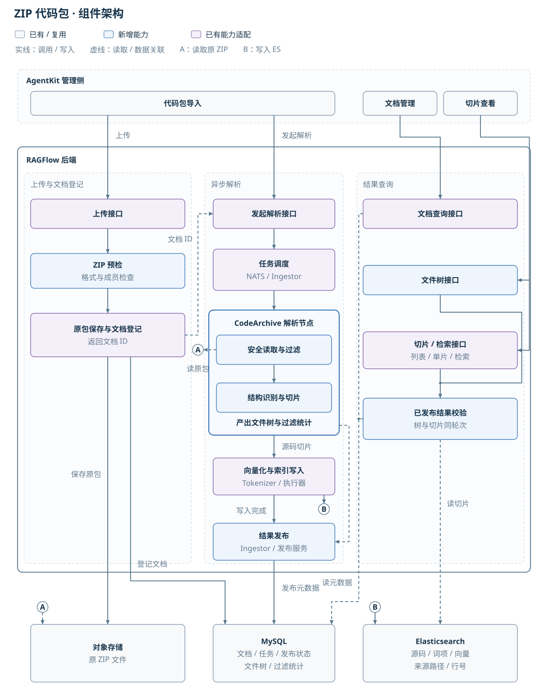
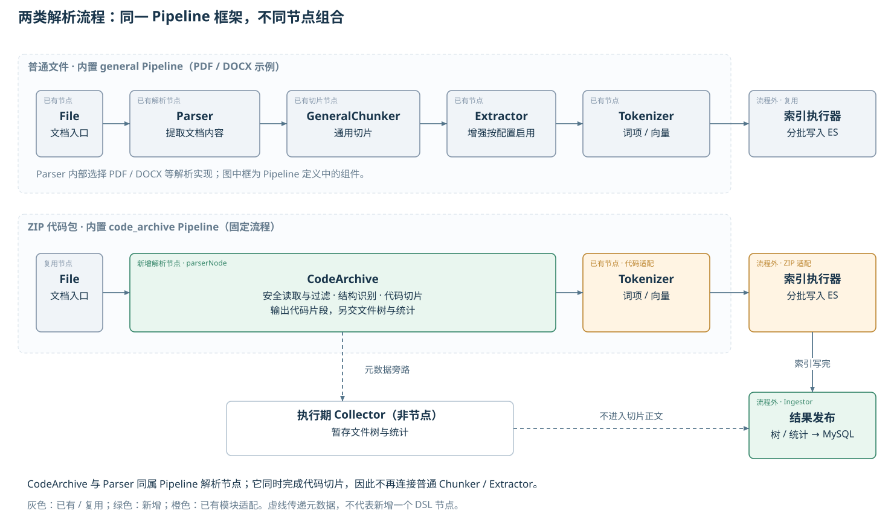
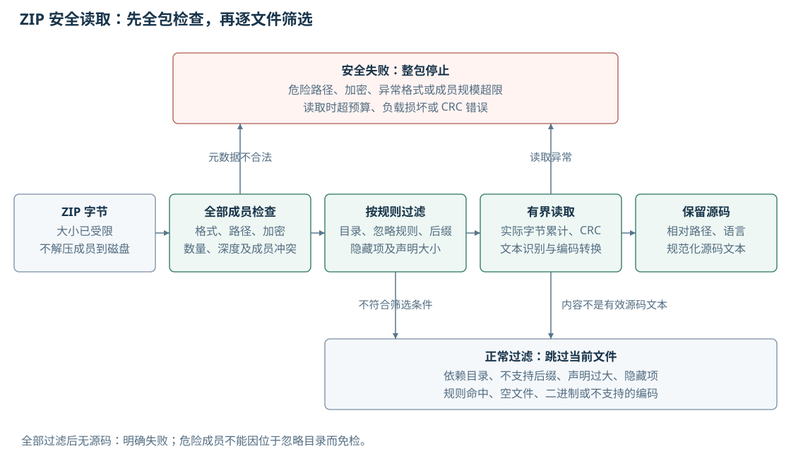
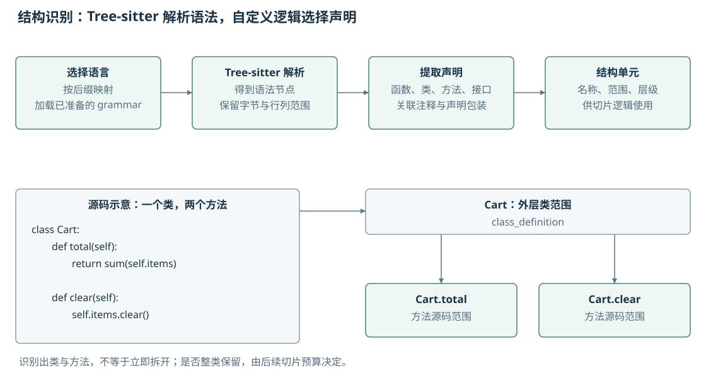
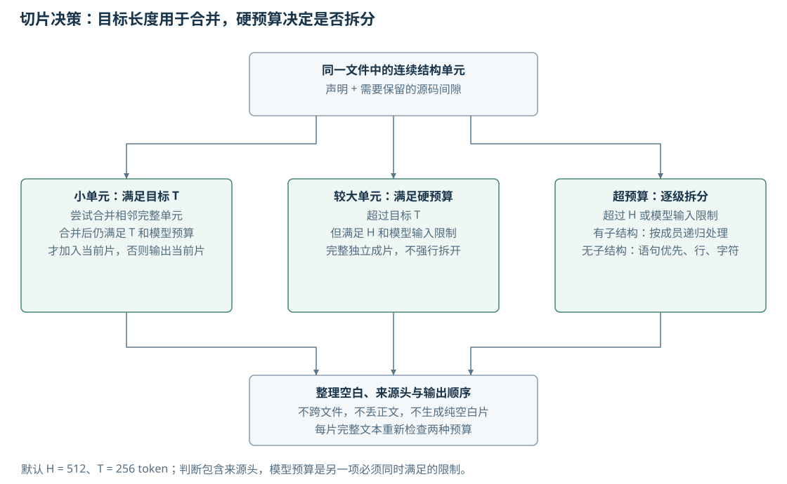
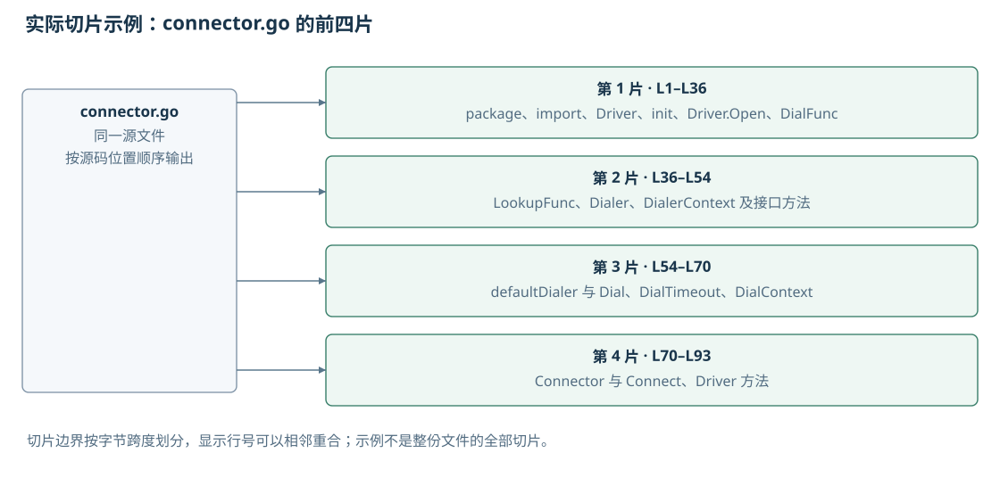
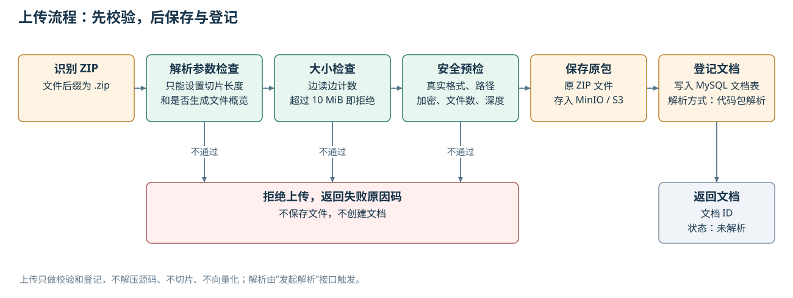
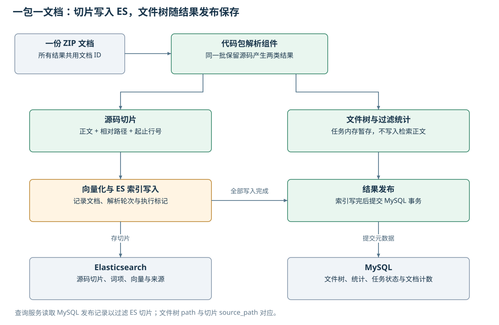

# ZIP 代码包导入与解析详细设计

RAGFlow Go 后端 · 2026-11-18

本文说明 RAGFlow 如何接收 ZIP 代码包，安全取得源码，识别代码结构，生成可检索切片，并提供文档状态、文件树和切片查询。**核心处理是“安全读取 → 结构识别 → 切片生成”；上传、任务调度、存储与查询围绕这条链路衔接。**

设计依据为《知识库支持上传与解析.zip文件与代码仓库》v1.0，以及《ZIP代码包解析核心特性设计》。本文只说明管理侧需要的功能如何由后端接口支撑，不展开页面、来源授权或管理侧内部实现。

## 1. 总体架构 {#overall}

RAGFlow 后端分为三个功能区：**上传与文档登记、异步解析、结果查询**。功能区内部保持独立流程，区间通过文档 ID、解析结果和共享存储关联。



图中灰色表示已有 / 复用，蓝色表示新增能力，紫色表示已有能力适配。**CodeArchive 外框内包含安全读取与过滤、结构识别与切片，以及文件树和过滤统计生成；向量化、索引写入与结果发布在框外。** 颜色表示能力变化，不表示独立部署单元；任务调度中的 NATS 直接复用，任务服务和 Ingestor 增加 ZIP 适配。上传侧 ZIP 预检调用同一解析库的检查能力，不是执行 CodeArchive 流水线节点。

A 表示读取对象存储中的原 ZIP，B 表示向 Elasticsearch 写入切片；同字母连接点代表同一条连接。MySQL 的登记、发布与读取直接连线。文档 ID 的虚线是数据关联，不表示上传接口自动调用解析接口。图中只展开导入与查看主线，停止、删除等操作见[第 4 章](#integration)。

### 1.1 功能区与组件职责 {#components}

| 功能区 | 主要组件 | 输入与输出 |
|---|---|---|
| 上传与文档登记 | 文档接口、DocumentService、ZIP 预检 | 接收 ZIP 字节；保存原包、创建一条文档，返回文档 ID |
| 异步解析 | IngestionTaskService、NATS、Ingestor、CodeArchive、Tokenizer、索引执行器 | 按文档 ID 取得原包；生成源码切片及文件树，写入索引并发布结果 |
| 结果查询 | 文档查询、文件树查询、切片与检索服务 | 读取文档状态；根据当前已发布记录返回文件树、切片及来源信息 |

CodeArchive 是代码包专用组件，内部调用 `codearchive` 解析库；该库完成安全读取、结构识别、切片及文件树构建，**不访问数据库、不调用远端模型、不自行发布结果**。固定解析流程为 `File → CodeArchive → Tokenizer`，索引执行器与 Ingestor 完成写入和发布。

### 1.2 三类数据分别存放 {#storage}

| 数据 | 存储位置 | 写入与读取方式 |
|---|---|---|
| 原 ZIP 文件 | 对象存储，MinIO / S3 | 上传服务保存，解析组件有界读取；包内成员不解压落盘 |
| 文档、任务、文件树、统计、发布记录 | MySQL 元数据库 | 复用文档与任务表；ZIP 扩展表保存文件树、解析快照与执行记录 |
| 源码切片、分词、向量、来源路径和行号 | Elasticsearch 文档引擎 | 执行器写入；切片查询与检索按已发布结果过滤 |

文件树和过滤统计是元数据，不混入切片正文或向量。文件树与切片从同一批保留源码生成；发布后通过文档 ID 与解析轮次保持对应关系。MySQL 与 Elasticsearch **不构成一个跨系统原子事务**，可见性由发布记录控制。

### 1.3 普通文件与 ZIP 代码包的解析流程 {#pipeline-comparison}

**CodeArchive 是现有 Pipeline 体系中的新增解析节点，与 Parser 同级，不是绕开流水线执行的独立解析服务。** 两类文档复用任务调度与执行框架，区别在于内置流水线的节点组合及职责分配。



- **普通文件，以内置 general 模板处理 PDF / DOCX 为例**：`File → Parser → GeneralChunker → Extractor → Tokenizer`。Parser 内部选择文件格式对应的解析实现，输出内容；GeneralChunker 负责通用切片；Extractor 位于流程中，但增强功能按参数启用，不能因此认定默认一定调用大模型。其他模板可换用 TitleChunker 等切片节点，不代表所有文件都走同一种组合。
- **ZIP 代码包使用固定内置流程**：`File → CodeArchive → Tokenizer`。CodeArchive 同时完成安全读取、过滤、语言结构识别和专用切片，直接输出标准代码切片，所以不再额外连接普通 Chunker，也不继承 Extractor 增强节点。File 复用文档入口，Tokenizer 复用词项与向量能力并增加代码场景适配。
- **框外的保存与发布不是额外 Pipeline 节点**：索引执行器负责分批写入 ES；ZIP 的文件树、统计经本次执行的 Collector 单独返回，随后由 Ingestor 在索引完成后发布。它们不混入切片正文，详见 [4.3 两路结果与发布](#publication)。

节点同级表示采用相同的组件注册与执行机制，不表示已开放给用户在任意自定义流程中自由组合；ZIP 固定使用 `parser_id=code_archive`。该流程图对照的是运行中的内置模板及后端组件，不构成新增前端编辑器交付。

## 2. 后端需求与设计目标 {#requirements}

以下需求点覆盖从 ZIP 接收、源码处理到结果查询的后端能力；功能规则以需求 PDF 为准，具体机制以源码实现为依据。

| 编号 | 需求点 | 设计目标 | 设计位置 |
|---|---|---|---|
| F1 | 大小校验、安全解压、默认过滤（需求 PDF 第 4～6 页） | 从不可信 ZIP 安全取得允许的源码；危险输入整包失败，无关文件静默跳过 | [3.1 安全读取](#zip-reading) |
| F2 | 按文件、函数、类、接口等代码结构生成切片（第 2、6 页） | 识别声明、注释关联及准确源码范围，为切片提供结构依据 | [3.2 结构识别](#structure) |
| F3 | 代码切片生成与索引，用于问答和检索（第 1、2、6 页） | 按结构合并和拆分，控制完整输入预算，保留路径与行号，不截断源码 | [3.3 切片生成](#chunking) |
| F4 | 一包一条原始文档，文件树展示相对路径（第 4、6、7 页） | 包内文件不建多个一级文档；文件树与切片归属同一 ZIP，并提供对应查询 | [4.1 文档登记](#upload)、[4.4 查询](#queries) |
| F5 | 异步导入、后端最终校验、失败原因可查询（第 5 页） | 复用任务调度；只发布完整结果；提供状态、失败原因和清理能力 | [4.2 任务衔接](#execution)～[4.5 生命周期](#lifecycle) |

**需求规定结果，设计决定方法。** Go ZIP 库、Tree-sitter、token 上限、合并比例以及执行租约是技术选择，不是需求原文指定的实现。

三项范围差异需明确保留，不能用设计说明代替需求确认：

- **大小单位**：需求写“10MB”；实现为 10 MiB（10,485,760 字节），还受普通上传上限约束。若验收使用十进制 MB，需要统一口径。
- **配置段落**：需求提到配置段落，但给出的源码白名单不含 YAML / JSON；本设计不实现配置文件分段。
- **文件树范围**：有效树只包含成功保留的源码及其父目录；过滤清单另行返回被跳过的路径、原因和文件数，支持灰显“已过滤 / 部分过滤”。README、JSON 等可作为过滤诊断节点展示，但不解析正文、不生成切片。

## 3. 核心解析设计 {#core-design}

三个阶段由一次代码包解析连续完成，不需要分别调用“解压”“语法分析”“切片”接口。先检查全部成员元数据，再逐个文件执行过滤、读取、结构识别和切片；不是先将全包全部解压后再处理。

### 3.1 F1：安全读取与文件过滤 {#zip-reading}

**输入是不可信 ZIP，输出是安全、可解析的源码文本。** 采用 Go 标准库 `archive/zip` 读取目录和解压成员；准入规则、路径检查、过滤和读取预算由 `codearchive` 模块实现。



#### 3.1.1 为什么分两次检查 {#zip-checks}

| 阶段 | 检查内容 | 不包含的工作 |
|---|---|---|
| 上传预检 | 接收大小、真实格式、全部成员的路径、类型、加密、数量和深度 | 不完整解压源码，不做语法分析或切片 |
| 异步解析 | 重复包格式与成员元数据检查；对实际读取的内容核对预算、文件头及 CRC | 不执行源码，不将成员解压到磁盘 |

相同的是**格式与成员元数据规则**；实际解压字节量和负载 CRC 在读取成员时检查。已按目录、后缀或声明大小过滤的成员，不为检查 CRC 而完整解压其负载。逐项输入、处理和预期结果见[附录 C：安全检查与文件过滤用例](#safety-examples)。

#### 3.1.2 安全检查与过滤是两种结果 {#zip-safety}

| 输入情况 | 处理方式 | 设计原因 |
|---|---|---|
| [非允许格式、异常目录或文件头](#safety-example-format) | 整包拒绝 | 只接受无前缀 ZIP / 单卷 ZIP64，压缩方法限 Store、Deflate；校验目录必须与读取器实际使用的目录一致 |
| [`..`、绝对路径、盘符、不安全字符](#safety-example-path) | 整包拒绝 | 先规范分隔符，再检查路径；危险路径不能借忽略目录绕过检查 |
| [软链接、非常规文件类型、重名或路径冲突](#safety-example-member-type) | 整包拒绝 | 防逃逸和歧义；重名按规范化后的大小写不敏感路径判断 |
| [加密成员、文件数或深度超限](#safety-example-limits) | 整包拒绝 | 全包检查在读取正文前执行，不尝试解密 |
| [实际读取超预算、候选成员损坏或 CRC 错误](#safety-example-read-budget) | 整包失败 | 立即停止，不输出截断正文或部分成功结果 |
| [依赖目录、规则命中、隐藏项、非源码后缀、声明过大](#filter-example-order) | 静默跳过当前文件 | 正常筛选，不作为整个代码包失败 |
| [读取后的空内容、二进制或不支持的编码](#filter-example-content) | 静默跳过当前文件 | 不将无效文本交给语法分析 |

**压缩炸弹防护依赖实际输出字节，不依赖压缩包声明大小或单一压缩比。** 每次读取都受单成员预算和整包累计预算限制；读取 `.gitignore` 同样计入累计值。默认资源限制见[附录 A](#configuration)。

目录项接受两种分隔符，包括 PowerShell 5.1 生成的零长度反斜杠目录项；`./` 等安全相对根目录项省略。目录项同样先检查类型、加密、格式与路径，目录携带非空负载时拒绝。

#### 3.1.3 过滤顺序与源码范围 {#zip-filter}

过滤顺序固定为：压缩包辅助项 → 忽略目录 → `.gitignore` → 隐藏项 → 语言 / 后缀白名单 → 声明大小 → 读取后的内容检查。

- 辅助项包含 `__MACOSX`、`.DS_Store`、`._*`；固定忽略目录包含 `.git`、`.svn`、`.hg`、`node_modules`、`__pycache__`、`.idea`、`.vscode`、`dist`、`build`、`target`、`vendor`、`.venv`、`venv`。
- 各层 `.gitignore` 只作用于对应目录及子目录；取反规则不能重新放行硬性目录或白名单排除的文件。
- `.gitignore` 可作为规则文件被有界读取，但本身不生成切片。声明超过规则文件上限则不加载；实际读取突破预算仍属于安全失败。
- 规则文件逐行解码，NUL 按 Git 语义终止当前行的模式；无法解码的行跳过，其他有效规则继续生效。
- 全部文件都被过滤后，返回 `ZIP_NO_SUPPORTED_FILES`，不返回一个空的成功结果。

需求的 9 种语言共对应 19 个后缀：

| 语言 | 源码后缀 |
|---|---|
| Python | `.py` |
| Go | `.go` |
| Java | `.java` |
| JavaScript | `.js`、`.jsx` |
| TypeScript | `.ts`、`.tsx` |
| Vue | `.vue` |
| C | `.c` |
| C++ | `.cpp`、`.cc`、`.cxx`、`.hpp`、`.h`、`.hxx` |
| Lua | `.lua`、`.lh`、`.ls`、`.li` |

正文支持 UTF-8（含 BOM）和 GBK，解码后去除 BOM、将 CRLF / CR 换行为 LF。文件名优先使用有效 UTF-8 或经校验的 Unicode Path 元数据；其余采用 CP437，仅在符合限定条件时尝试 GBK 修复。文件名无法对所有字节组合无歧义识别，推荐使用 UTF-8 文件名。

**输出**：每个保留文件的安全相对路径、语言和规范化源码文本，以及过滤统计。所谓“内存读取”是指成员不落盘，原 ZIP 仍存对象存储。

规则示例（用于解释处理条件）：

| 包内成员 | 结果 |
|---|---|
| `src/math.go`，有效文本 | 保留，进入结构识别 |
| `node_modules/lib/index.js` | 因依赖目录静默跳过 |
| `README.md`、`config/app.json` | 因后缀不在白名单静默跳过 |
| `src/generated.go`，声明为 2 MiB | 因单源码声明过大静默跳过 |
| `node_modules/../../escape.go` | 整包失败，不能因处于忽略目录而免检 |

### 3.2 F2：代码结构识别 {#structure}

**Tree-sitter 提供语法结构，自定义规则选取声明，切片器决定怎么切。** 使用 `go-tree-sitter` 与 `tree-sitter-language-pack` 的语言 grammar，获得带源码位置的具体语法树（CST），不依赖项目编译成功。



#### 3.2.1 语法解析技术选型 {#structure-parser-choice}

**选型结论：采用 Tree-sitter 作为多语言语法解析底座，不将其视为现成的代码切片器。** Tree-sitter 已用于 [GitHub 代码导航](https://docs.github.com/en/repositories/working-with-files/using-files/navigating-code-on-github)和 [Neovim 语法解析](https://neovim.io/doc/user/treesitter/)。这些应用说明其在代码结构处理领域已有成熟实践，但不能直接证明本功能的切片质量；切片效果仍由具体规则与语料验证支撑。

本功能选择 Tree-sitter，主要基于以下条件：

- **多语言共用解析接口**：通过不同 grammar 支持源码白名单中的语言，统一取得节点类型、层级和位置。各语言的节点定义并不完全一致，声明识别仍需分别适配。
- **无需编译或补齐项目依赖**：按文件解析源码，即使 ZIP 缺少依赖、构建配置或仅含部分项目，也可提取语法结构；不要求运行代码或下载项目依赖。
- **语法错误容错**：解析器能在存在语法错误时返回可识别部分和错误信息，适合不完整源码。是否继续使用这些结构、何时按行降级，由代码包模块判断，不由库自动决定。
- **按原文位置切分**：节点携带字节范围和行列位置，切片器据此截取原文，不从语法树重新生成代码，有利于保留注释、格式和准确来源。

Tree-sitter 的增量解析适合编辑器场景；本功能执行离线整文件解析，**不以增量更新能力作为主要选型理由**。

其他方案的适用边界如下：

- **各语言专用解析器或编译器工具**：例如 Go `go/parser`、TypeScript Compiler API、Clang。仅需单一语言 AST 时可直接使用；需要类型解析、精确符号绑定或跨文件语义时，应优先评估对应语言工具链。多语言统一接入需要维护不同接口和运行环境，部分深层分析还依赖完整项目配置，超出本次结构切片目标。
- **ANTLR**：适合自定义语言、DSL，或已有合适 grammar 的解析工程。本需求不设计新语言；采用它同样需要验证各语言 grammar、容错行为及源码范围，并自行实现声明选择和切片规则，不因替换解析器而省去这些工作。
- **正则、按行或按 token 切分**：实现和部署简单，但难以稳定识别嵌套结构、装饰器、多行声明及混合语言边界。本设计以语法结构为主，按行或字符切分作为降级手段，不以正则代替完整语法解析。

**职责与代价**：Tree-sitter 及其 grammar 负责生成语法树、源码位置和错误信息；代码包模块负责语言选择、声明提取、注释归属、Vue / `.h` 适配及降级策略，切片器负责预算内合并与拆分。该方案不提供完整类型检查或跨文件调用关系；需要持续验证 grammar 对新语法的支持，并准备 Go 绑定所需的 CGO / 原生资源。本选型依据场景匹配与已有语料验证，不宣称已完成所有替代方案的同条件性能对比。

#### 3.2.2 从源码到结构单元 {#structure-rules}

1. **选择语法解析器**：按后缀选择语言，加载部署时准备的 grammar。
2. **解析整个文件**：取得节点类型、父子关系、字节范围和行列位置。Tree-sitter 生成的是具体语法树（CST），不是大模型理解结果。
3. **选取声明及其范围**：函数、方法、类、结构体、接口、枚举、类型声明等作为候选单元。
4. **处理归属关系**：装饰器、`export`、`template` 随声明保留；无空行隔开的前导注释并入声明；方法名称可记录为 `Type.Method`。
5. **保留容器层级**：识别类及内部方法；类能完整放入切片时不必拆开，超预算时再使用内部成员范围。

函数内部的局部变量、匿名回调和 lambda 内部的声明不继续拆成独立检索单元，避免碎片化。import、全局变量、空白和其他结构外文本也必须保留，它们在切片阶段分配给连续源码跨度。

Tree-sitter 不执行代码、不调用大模型，不做跨文件调用关系推导或类型检查，也不直接生成最终检索切片。

#### 3.2.3 语言适配与降级策略 {#syntax-fallback}

Tree-sitter 提供各语言语法树和错误信息；下表的 grammar 选择、结果组合、错误阈值及降级行为由代码包模块实现，不是解析库自动提供的完整策略。

| 情况 | 设计规则 |
|---|---|
| [TypeScript / TSX](#syntax-example-tsx) | 使用独立 grammar，避免 JSX 与 TypeScript 语法混淆 |
| [`.h` 头文件](#syntax-example-header) | 先用 C++；错误比例超阈值时比较 C 结果，选择错误覆盖行数较少者 |
| [Vue](#syntax-example-vue) | 先按 HTML 识别块，script 按 `js / jsx / ts / tsx` 分析并换算回文件偏移；其他脚本语言按原文保留 |
| [少量语法错误](#syntax-example-partial-errors) | 使用可识别结构，不能因为错误节点而丢失源码 |
| [错误覆盖比例超过阈值](#syntax-example-line-fallback) | 去重错误行数 / 文件行数超过默认 20% 时，放弃不可靠结构，按行切分 |
| [缺少 grammar](#syntax-example-missing-grammar) | 返回 `ZIP_UNSUPPORTED_DEPLOYMENT`，不能伪装成按行降级，也不在请求中下载 |

Vue 不保留整文件的边界选择语法树，超预算片段按行处理；不能承诺与单语言文件相同的语句边界优化。逐项输入、处理与预期结果见[附录 B：语言适配与降级用例](#syntax-examples)。

**输出**：声明的名称、类别、字节范围、包含关系，以及降级标记。例如一个类含两个方法，输出是“外层类范围 + 两个方法范围”，不是立即生成三个切片。从源码结构到最终切片的完整对照见[附录 D：代码结构识别与切片用例](#structure-chunk-examples)。

### 3.3 F3：检索切片生成 {#chunking}

**保留可容纳的完整结构，合并相邻小结构，递归拆分超预算结构。** 自定义 `chunkBuilder` 基于源码位置操作文本，不从语法树重新打印代码。

#### 3.3.1 合并目标与硬上限分开 {#chunk-budget}

- **H：单片上限**，`chunk_token_num` 默认 512，允许 1～2048。
- **T：合并目标**，`T = max(1, floor(H × chunk_target_ratio))`，默认比例 0.5，得到 T=256；比例为 0 时关闭相邻声明合并。
- 每次计数包含**来源头 + 源码正文**，同时满足切片计数预算与嵌入模型预算。
- 切片计数使用 cl100k BPE；模型计数器及安全余量由应用注入。token 不是字符数或行数，两种计数也不一定相同。

**256 是合并目标，不是强制切断位置。** 一个完整函数含来源头为 300 token、模型也可接受时，应独立成片，而不是为了凑到 256 将它拆开。



#### 3.3.2 具体切分规则 {#chunk-rules}

1. **按文件形成连续源码单元**：文件间不合片；声明外文本能容纳时并入相邻单元，放不下则单独拆分，不能遗漏 import、注释或文件尾部。
2. **合并相邻小单元**：按源码顺序累加，完整候选片满足 T 与模型预算时合并，否则输出当前片。不跨过中间代码拼接，不按名称相似度跨文件合并。
3. **保留中等单元**：超过 T 但同时满足 H 和模型预算的完整单元独立成片，不再吸收相邻声明。
4. **递归拆分大单元**：优先拆为类头、成员等子结构，并对成员重复上述规则。无可用子结构时，先找到预算内能容纳的连续行范围，再在后半窗口优先选择较外层的语句边界；没有合适候选时按行拆分，单行仍超限则按 UTF-8 字符边界拆分。
5. **整理空白与来源头**：纯空白跨度并入邻片，必要时安全调整边界。若完整声明恰好占满预算，保留声明使相邻换行或空白无法安置，则最后允许进一步拆分声明。重新检查每片完整文本的双预算；仍无法同时满足完整性、非空和预算时明确失败。
6. **有序输出**：文件按相对路径排序，文件内保持源码顺序；不做重叠复制。

逐项实际用例见附录 D 的[注释归属](#chunk-case-comments)、[小函数合并](#chunk-case-merge)、[完整函数独立](#chunk-case-whole)、[大类递归拆分](#chunk-case-container)、[超长函数与单行拆分](#chunk-case-split)及[源码完整性](#chunk-case-rebuild)。

示意条件如下，数字用于解释决策，不是新的实测值：

| 输入情况，默认 H=512 / T=256 | 输出 |
|---|---|
| 两个相邻小函数，合并后的完整文本为 220 token，模型可接受 | 合为一片 |
| 一个完整函数为 300 token，模型可接受 | 独立成片 |
| 一个类为 900 token | 按类头与成员递归拆分 |
| 长方法已无可拆子声明 | 语句边界优先，退回按行，必要时按字符 |
| 切片计数未超 H，但模型输入超限 | 仍需拆分；不得截断文本后提交 |

#### 3.3.3 真实切片效果 {#chunk-example}

固定 openGauss Go 驱动语料：85 个文件中保留 66 个源码文件；H=512、比例 0.5、概览关闭时，生成 **677 个源码切片**。下图展示 `connector.go` 的前四片，不表示整个文件只有四片。



第 3 片的历史记录如下，仅将来源头中的长路径前缀缩写为 `…`。文中的驱动源码摘录来自上述固定上游提交，遵循其 [MIT 许可证](ZIP代码包导入与解析详细设计-20261115.assets/LICENSE.opengauss-go-driver.txt)；它们是阅读示例，不作为测试输入：

```text
// …/connector.go:L54-L70 defaultDialer, defaultDialer.Dial, defaultDialer.DialTimeout, defaultDialer.DialContext


type defaultDialer struct {
	d net.Dialer
}

func (d defaultDialer) Dial(network, address string) (net.Conn, error) {
	return d.d.Dial(network, address)
}
func (d defaultDialer) DialTimeout(network, address string, timeout time.Duration) (net.Conn, error) {
	ctx, cancel := context.WithTimeout(context.Background(), timeout)
	defer cancel()
	return d.DialContext(ctx, network, address)
}
func (d defaultDialer) DialContext(ctx context.Context, network, address string) (net.Conn, error) {
	return d.d.DialContext(ctx, network, address)
}
```

结构体和三个相邻方法在此例中同属一片，保留了相关上下文；不意味着所有类型与全部方法都必须合片，也不保证某个检索问题一定命中该片。

**无损的对象是规范化源码文本**：去掉来源头后，按顺序拼接全部源码片，逐字节还原编码转换、BOM 去除及换行规范化后的文本。相邻片的显示行号可以重合，但它们的字节跨度不重叠；不承诺还原原始 GBK 编码或 CRLF 字节形态。

每片保留相对路径、语言、起止行号和符号列表。来源头占用预算，长符号串可以缩短，完整符号列表另行保留，源码正文不能因此截断。可选文件概览默认关闭，开启时由语法符号生成、不调用 LLM；它是额外切片，不参与源码重建。

## 4. 结果存储与服务衔接 {#integration}

### 4.1 上传与文档登记 {#upload}

**上传只检查并保存，不开始解析。** 接收 ZIP 后依次检查参数、大小和成员元数据，将原包存入对象存储，在 MySQL 的 `document` 表登记一条文档，并固定 `parser_id=code_archive`。



复用原 File / Document / 文件关联机制；文档和关联记录在受知识库删除屏障保护的事务中登记，登记失败走对象补偿清理。同名再次上传创建独立文档，不覆盖原对象。响应中归档状态为 `unstart`，解析轮次为空。

ZIP 只通过受控本地文件上传入口导入；引擎的 URL 直接拉取、文件关联、对话附件、连接器同步等路径不得绕过预检。来源获取不改变引擎的接收契约。

### 4.2 异步任务与组件接入 {#execution}

发起解析接口接收文档 ID，复用原任务系统。它返回受理数量，不等待解析结束。上传与发起解析是两个接口能力，并不要求页面提供两个按钮。

1. 创建本次解析轮次，冻结原包身份、解析参数、安全策略和模型引用，保存到 `archive_run`。
2. 更新当前归档记录为等待执行，再投递 NATS 消息。
3. Ingestor 领取任务，建立一次实际执行及租约，装配可信上下文。
4. 固定流程 `File → CodeArchive → Tokenizer` 执行；CodeArchive 通过 `ReadOriginal` 读取原包并核对大小与内容标识。
5. CodeArchive 输出切片，同时把文件树、统计放入本次任务的内存收集器（Collector）；全包处理出错，不返回部分成功结果。

快照包含原包名称、对象位置、大小、内容标识，以及解析参数、策略和模型参数指纹；不保存 API 凭据。Snapshot 不是整份 DSL 或所有知识库字段的完整快照，执行前和发布前仍需核验模型一致性。

### 4.3 一包一文档：两路结果、一个发布点 {#publication}

**切片进入 ES，文件树进入 MySQL；两路都准备完成后，才允许查询本轮内容。**



#### 持久化对象 {#data-model}

ZIP 继续使用原文档和任务表，扩展表不替代它们。

| 表 / 存储 | 一条记录代表什么 | 保存内容 |
|---|---|---|
| `document`、`ingestion_task` | 一份文档及其任务 | 名称、大小、解析配置、切片数、token 数、进度、任务状态 |
| `document_code_archive` | 一份 ZIP 的当前归档记录 | 当前 Run / Attempt、发布状态、失败原因、`tree_json` 文件树、`stats_json` 统计 |
| `archive_run` | 一次逻辑解析 | 不可变的输入快照；重解析产生新 Run |
| `archive_attempt` | 某个 worker 的一次实际执行 | 执行身份、租约、发布或清理状态；同一 Run 重试可有多个 Attempt |
| `code_archive_dataset` | 一个知识库的删除屏障 | 协调 ZIP 上传、入队、发布与知识库删除 |
| Elasticsearch 切片行 | 一份文档的一段源码 | 正文、词项、向量、相对路径、行号、语言和 Run / Attempt 标记 |

“解析轮次”不是软件版本。它用于区分同一文档的多次解析；“执行尝试”用于区分重启接管或重投递中的不同 worker。MySQL 表通过 GORM 迁移建立，表间关联由业务校验保证。

#### 写入与发布顺序

1. 切片转换为标准 ChunkDoc，复用 Tokenizer 与模型服务生成词项和向量。
2. 索引执行器分批写入 ES，每条附文档、Run、Attempt 标记；每批写入前后检查执行资格。
3. 全部索引写入完成后，执行器把树、统计和计数返回 Ingestor。
4. Ingestor 核验当前任务、租约、模型与可用性，再在一个 MySQL 事务内提交：归档记录中的文件树、统计及 `ready` 状态；任务的 `COMPLETED` 状态；执行记录的 `published` 状态；原 `document` 表和知识库中的切片数、token 数等计数。

**文件树与过滤统计写入 `document_code_archive`，切片数更新原 `document.chunk_num`。** `stats_json` 保存分类数量及有界过滤清单；管理侧可据此说明哪些路径被跳过。过滤明细不进入 ES，不改变切片和检索内容。

索引写入成功不等于已发布。若过程失败，尚未发布的索引行不可见并由清理机制回收；若 MySQL 提交结果不确定，先核实状态，不能盲目删除可能已经发布的切片。

#### 向量化与检索适配

- 来源路径参与标题词项生成；函数、类等符号写入加权词项，驼峰与下划线拆分用于全文匹配，不追加进源码正文。
- 向量化必须使用完整切片。Provider 批次越限时二分隔离；单条仍被拒绝时短暂原文重试，再失败则返回 `ZIP_TOKEN_LIMIT_EXCEEDED`，不能截短后发布。
- 向量缓存关联模型引用、参数指纹和实际文本，避免模型变化后复用错误向量。
- 非测试意图问题可按 `test_source_weight`（默认 0.95）降低测试源码得分；只影响排序，不过滤结果，不影响普通文档。

### 4.4 文件树、切片与文档状态查询 {#queries}

文件树由保留源码的安全相对路径构建，目录排在文件前，每层按名称排序；`tree` 只包含已保留文件和必要父目录。`root_name` 为公共顶层目录名，无公共顶层目录时取 ZIP 文件名去掉后缀；不能把它再次拼入节点路径。

`stats.filtered_entries` 单独记录被过滤的路径、文件 / 目录类型、原因和影响文件数。解析时在真实跳过点记录，只合并规则整体排除的目录；单个文件被过滤不意味着其父目录整体被过滤。例如 `node_modules` 可灰显为“已过滤：依赖目录”，而同时含有效源码和被过滤文件的 `src` 应显示“部分过滤”。目录条目的原因解释整目录排除，分类统计仍按各文件的首个命中原因计数；文件数不计目录占位项。

过滤清单上限为 512 条、128 KiB，并受执行产物总上限约束；必要时裁剪清单并返回 `filtered_entries_truncated=true`，总数和分类数量不丢失，保留的目录条目计数仍完整。被过滤路径只作为诊断元数据，既不生成切片，也不为展示而读取已排除文件的内容。权限、发布和重解析替换规则与有效树相同。

**一个文件可对应多个切片**，通过 `source_path` 与树节点 `path` 对应，不是一文件一切片。文件树保存在 MySQL，切片保存在 ES，两个查询均校验文档权限及发布记录。

| 查询对象 | 对外字段 | 含义 |
|---|---|---|
| 文档 | `ingestion_status` | 任务状态：排队、运行、停止中、完成或失败等 |
| 文档 | `archive_status` | 归档状态：`unstart` 未解析、`pending` 等待 / 执行中、`ready` 已发布、`failed` 失败、`stopped` 已停止；删除过渡期可为 `deleting` |
| 文档 | `archive_run_id`、`archive_failure_reason`、`chunk_count` | 当前轮次、失败原因码、原有切片数 |
| 文件树 | `status` | `ready` 可读取、`not_ready` 无已发布树；未解析、解析中、失败或停止都可能为 `not_ready` |
| 文件树 | `doc_id`、`archive_run_id`、`root_name`、`tree`、`stats` | 文档归属、已发布轮次、根名、目录树及诊断统计 |
| 切片 | `source_path`、`start_line`、`end_line`、`code_lang`、`archive_run_id` | 包内相对路径、一基闭区间行号、语言和解析轮次 |

文件树响应示例：

```json
{"code":0,"message":"success","data":{"doc_id":"doc_001","status":"ready","archive_run_id":"run_001","root_name":"snapshot","tree":[{"name":"src","path":"src","type":"directory","children":[{"name":"math.go","path":"src/math.go","type":"file"}]}]}}
```

未发布时返回 `status=not_ready`、`archive_run_id=null`、`tree=[]`，不携带待执行轮次和失败原因；这些信息从文档查询取得。非 ZIP 请求文件树返回 `ZIP_NOT_ARCHIVE`。

切片及检索沿用原结果结构，仅补充来源字段。每片正文带来源头；公开来源字段不使用 ES 的 `_kwd / _int` 后缀。分页与统计先按已发布执行集合过滤，再对读回行复核，不能先取一页再丢弃不可见片。

文件树和切片的两次请求不是跨库一致性快照；重解析可能发生在两次查询之间。返回的 `archive_run_id` 不一致时，应重新查询，不混合不同轮次内容。成功展示以任务 `COMPLETED` 且归档 `ready` 为准。

### 4.5 停止、重解析与删除 {#lifecycle}

| 操作 | 后端处理规则 |
|---|---|
| 停止 | 运行任务先进入 `STOPPING`，取消执行并结算为 `STOPPED`；以任务状态而非归档 `stopped` 判断停止是否完成 |
| 重解析 | 同一文档创建新 Run；清旧重解析会先清理旧结果，不保证失败后仍可读取旧切片 |
| worker 中断 | 无用户停止请求时，释放当前执行并保留重投递资格；接管产生新 Attempt，不提前标记解析失败 |
| 启用 / 禁用 | 沿用文档和切片可用性，更新范围限定到当前发布结果 |
| 删除文档 | 运行或停止中不删除，返回 `deleted=0`；停止完成后删除文档、关联、树和结果，保留必要清理记录 |
| 删除知识库 | 通过删除屏障阻止并发上传、入队和发布；索引残留由后续清理回收 |

执行租约默认 30 秒，每 10 秒续租，续租超时 5 秒。清理器每 300 秒扫描，宽限 600 秒，每批 100 条；只清理指定文档、Run、Attempt 的索引，不删除其他执行的结果。清理记录不自动过期，旧 Run 快照在删除文档 / 知识库时清理。

## 5. 后端接口支撑 {#interfaces}

本章只列功能与接口关系，不设计管理侧内部实现。所有路径以 `/api/v1` 为前缀，鉴权沿用 `Authorization: Bearer <API Key>`，文档必须属于指定知识库及授权范围。

### 5.1 新增与改造接口 {#changed-interfaces}

| 接口名称 | 功能 | API | 类型 |
|---|---|---|---|
| 查询文件树 | 展示 ZIP 目录和文件的相对路径 | `GET /datasets/{dataset_id}/documents/{document_id}/archive_tree` | 新增 |
| 上传文档 | 校验 ZIP、保存原包、登记文档 | `POST /datasets/{dataset_id}/documents?type=local` | 改造 |
| 查询文档 | 获取文档列表、解析状态、切片数与失败原因 | `GET /datasets/{dataset_id}/documents` | 改造 |
| 查询切片列表 | 分页返回源码正文和来源路径、行号 | `GET /datasets/{dataset_id}/documents/{document_id}/chunks` | 改造 |
| 查询单个切片 | 返回当前已发布的指定切片 | `GET /datasets/{dataset_id}/documents/{document_id}/chunks/{chunk_id}` | 改造 |
| 检索 | 检索已发布源码并返回来源信息 | `POST /retrieval` | 改造 |
| 更新文档 | 调整允许的解析参数、启用或禁用文档 | `PATCH /datasets/{dataset_id}/documents/{document_id}` | 改造 |
| 新增切片 | ZIP 拒绝手工新增，保持源码与树一致 | `POST /datasets/{dataset_id}/documents/{document_id}/chunks` | 改造：ZIP 只读 |
| 修改切片 | ZIP 拒绝手工改正文 | `PATCH /datasets/{dataset_id}/documents/{document_id}/chunks/{chunk_id}` | 改造：ZIP 只读 |
| 删除切片 | ZIP 拒绝单独删除切片 | `DELETE /datasets/{dataset_id}/documents/{document_id}/chunks` | 改造：ZIP 只读 |
| 删除文档 | 清理文档、归档元数据及索引结果 | `DELETE /datasets/{dataset_id}/documents` | 改造 |

“改造”表示原接口增加 ZIP 字段、限制或执行保护，不代表新建路由。ZIP 切片正文只读，但不禁止现有的切片启用 / 禁用操作。

### 5.2 沿用的任务操作 {#task-interfaces}

以下操作的请求与返回格式沿用原接口；后端执行增加 ZIP 快照、租约和发布保护。

| 接口名称 | 功能 | API | 类型 |
|---|---|---|---|
| 发起解析 | 首次解析、失败或停止后重试 | `POST /datasets/{dataset_id}/documents/parse` | 沿用 |
| 停止解析 | 停止排队或执行中的任务 | `POST /datasets/{dataset_id}/documents/stop` | 沿用 |
| 清旧重解析 | 清除旧结果后重新处理文档 | `POST /datasets/{dataset_id}/chunks` | 沿用 |
| 切片启停 | 设置已发布切片的可用性 | `PATCH /datasets/{dataset_id}/documents/{document_id}/chunks` | 沿用 |

### 5.3 接口使用约束 {#api-contract}

- **上传**：multipart 的 `file` 为 ZIP；可选 `parser_config` 必须使用下面的组件作用域。上传成功返回 `data[]` 中的文档 `id`，不是解析结果。
- **发起 / 停止 / 重解析**：使用 `document_ids`。发起解析的 `data.success_count` 为受理数，可能为 0；已完成文档的清旧重解析使用 `/chunks`，不能混同普通 `/documents/parse`。
- **状态**：使用 `GET /documents?id={document_id}` 查询。`GET /documents/{document_id}` 是下载原文件，不是状态接口。
- **切片列表**：`page` 默认 1，`page_size` 默认 30、范围 1～100，`keywords` 可选；返回 `data.chunks / doc / total`。
- **检索**：`dataset_ids`、`question` 必填，`document_ids` 可选；结果沿用 `data.chunks / doc_aggs / labels / total`。
- **删除**：使用 `ids`，检查 `data.deleted`；运行中须先停止并等待任务 `STOPPED`。
- **启停**：文档 PATCH 使用 `enabled`（0 / 1）；切片 PATCH 使用 `chunk_ids`、`available_int`（0 / 1）。

```json
{"CodeArchive:Archive":{"chunk_token_num":512,"code_file_overview":false}}
```

这两个参数分别表示单片 token 上限和是否生成文件概览。ZIP 不允许切换普通解析器或自定义 Pipeline；OCR、普通文本分段和 LLM 增强参数不能进入代码包流程。

## 6. 验证与交付边界 {#verification}

### 6.1 核心验收判据 {#acceptance}

| 能力 | 判据 | 已有验证 |
|---|---|---|
| 安全读取 | 危险成员整包拒绝；过滤不绕过安全检查；实际读取受限 | 路径、成员类型、加密、ZIP64、伪造目录、CRC 与预算单测 |
| 结构识别 | 后缀选对 grammar；声明范围有效；注释和包装保留；降级与部署错误分开 | 真实 grammar、匿名回调、Vue、头文件和错误降级测试 |
| 切片生成 | 目标与硬上限分开；不跨文件、不遗漏、不重复；完整文本符合双预算 | 合并 / 拆分测试；openGauss 66 个文件、677 片全部重组；174 个符合预算的函数与注释组合完整保留 |
| 存储与查询 | 文件树和切片只返回已发布结果；来源能定位；中断和删除不泄露残留 | MySQL 8.0.40 + ES 8.11.3 的迁移、ES 集成及真实 HTTP 链路 |

上述真实链路在 Linux ARM64、ES 开启密码认证的环境通过：空库和重复迁移、上传、解析、源码重组、向量与检索、停止与失败原因、解析中重启、运行中删除。重启场景最终只有一个发布结果，677 条向量逐条核对；停止后删除并观察超过 95 秒，未出现迟到结果。

70 道中文问题、7 个固定公开仓库的检索评测提供策略选择依据。默认策略在开发集 Hit@5 为 26/40、MRR@10 为 0.521，留出集 Hit@5 为 20/30、MRR@10 为 0.543；使用 bge-m3、ES 9.5.6、混合检索，无重排。结果只描述该基准，不是对所有代码问题的效果保证。

### 6.2 不承诺的范围 {#boundaries}

- 不支持 Git 克隆、持续同步、嵌套 ZIP 递归解析、配置文件分段或 ZIP 切片手工编辑。
- `SourceTransform` 只预留源码预处理与行映射契约，默认恒等处理；不表示已有脱敏规则。
- 原型中的通用 OCR / 分段选项及 README / JSON 正文解析不在 ZIP 后端支持范围；被过滤路径可以作为诊断节点展示，不代表内容被接收或索引。
- ZIP 导入与解析仅支持 MySQL 元数据库 + Elasticsearch 文档引擎；其他组合拒绝 ZIP，返回 `ZIP_UNSUPPORTED_DEPLOYMENT`，不影响其普通文档能力。其他 CPU 架构及生产并发负载不在已验证范围内。
- 需求与实现的大小单位、配置段落、文件树展示范围差异见[第 2 章](#requirements)，仍需按产品验收口径确认。

## 附录 A. 配置与错误定位 {#configuration}

### A.1 部署配置 {#policy}

`service_conf.yaml` 的 `code_archive` 节控制以下策略，可由 `RAGFLOW_CODE_ARCHIVE_` 前缀环境变量覆盖；API 与 Ingestor 使用一致配置，入队后按冻结的 Policy 执行。默认值如下，资源上限只允许在硬限制内调整。

| 字段 | 默认值 | 含义 |
|---|---|---|
| `max_archive_bytes` | 10 MiB | 压缩包字节上限，取普通上传限制与其较小值 |
| `max_members` | 5,000 | 文件成员上限，不计目录项 |
| `max_depth` | 20 | 相对路径层数 |
| `max_uncompressed_bytes` | 100 MiB | 累计实际解压读取预算，包含忽略规则 |
| `max_file_bytes` | 1 MiB | 单源码限制；声明超限跳过，实际读取超限失败 |
| `max_gitignore_bytes` | 64 KiB | 单个规则文件限制 |
| `max_chunks` | 100,000 | 总切片数，含可选概览 |
| `artifact_max_bytes` | 8 MiB | 树、统计等解析产物的序列化上限 |
| `ignored_dirs` | 空扩展列表 | 在固定忽略目录外追加目录 |
| `respect_gitignore` | true | 是否使用包内忽略规则 |
| `languages` / `extensions` | [3.1 源码白名单](#zip-filter) | 只能收紧为支持集合的非空子集 |
| `syntax_error_ratio` | 0.2 | 语法降级阈值，取值 0～1 |
| `default_chunk_token_num` | 512 | 单片预算的默认值，取值 1～2048 |
| `chunk_target_ratio` | 0.5 | 合并目标比例，取值 0～1；0 为关闭合并 |
| `test_source_weight` | 0.95 | 检索测试源码降权系数，取值 (0,1]；1 为关闭，不冻结到解析快照 |

`code_archive_cleanup` 单独控制清理调度：`interval_seconds=300`、`grace_seconds=600`、`batch_size=100`。语法依赖由 `tools/code_archive/prepare.sh` 准备缓存，不能在处理请求时下载；Go 依赖为 `go-tree-sitter` v0.25.0、`tree-sitter-language-pack/packages/go` v1.13.3。

### A.2 错误传递 {#errors}

单 ZIP 上传和文档 PATCH 的类型化归档错误通过 `data.reason_code` 返回；异步失败通过 `archive_failure_reason` 查询。其他入口可能沿用 message，不承诺所有错误都有相同包装或 HTTP 状态。对外不暴露服务器路径、源码正文或内部堆栈。

| 原因码 | 含义 |
|---|---|
| `ZIP_SIZE_EXCEEDED` | 原包压缩字节数超限 |
| `ZIP_INVALID_FORMAT` | 非允许 ZIP、异常目录或压缩方法 |
| `ZIP_UNSAFE_PATH` | 危险路径、软链接、重名或成员冲突 |
| `ZIP_ENCRYPTED` | 存在加密成员 |
| `ZIP_TOO_MANY_FILES` / `ZIP_TOO_DEEP` | 成员数 / 路径深度超限 |
| `ZIP_CORRUPTED` / `ZIP_BOMB_SUSPECTED` | 内容损坏 / 实际读取超预算 |
| `ZIP_NO_SUPPORTED_FILES` | 空包或过滤后无源码 |
| `ZIP_CONFIG_INVALID` / `ZIP_TOO_MANY_CHUNKS` | 配置或切片预算无效 / 切片数超限 |
| `ZIP_UNSUPPORTED_DEPLOYMENT` | 缺 grammar 或计数器等运行能力 |
| `ZIP_SOURCE_CHANGED` / `ZIP_EMBEDDING_CHANGED` | 原包或模型与冻结输入不一致 |
| `ZIP_SNAPSHOT_MISSING` / `ZIP_SNAPSHOT_INVALID` | 解析快照缺失或内容非法 |
| `ZIP_TOKEN_LIMIT_EXCEEDED` | 模型不能接收完整切片 |
| `ZIP_ARTIFACT_LIMIT_EXCEEDED` | 文件树与统计等产物体积超限 |
| `ZIP_NOT_ARCHIVE` / `ZIP_NOT_PUBLISHED` | 非 ZIP 查询 / 内容尚未发布 |
| `ZIP_CHUNK_METHOD_LOCKED` / `ZIP_CHUNKS_READ_ONLY` | 不允许切换解析方式 / 不允许编辑源码切片 |
| `ZIP_NOT_ALLOWED_HERE` / `ZIP_PARSE_FAILED` | 不受支持的入口或执行身份 / 其他归档失败 |

其他入口标识包括：`ZIP_ONLY`、`ZIP_PARSER_LOCKED`、`ZIP_CONFIG_LOCKED`、`ZIP_LOCAL_UPLOAD_ONLY`、`ZIP_ATTACHMENT_UNSUPPORTED`、`ZIP_ASSOCIATION_UNSUPPORTED`、`ZIP_CONNECTOR_UNSUPPORTED`、`ZIP_DATASET_UNAVAILABLE`，用于限制不受控导入和不可用知识库操作。

### A.3 实现与证据入口 {#evidence}

| 设计内容 | 源码入口 |
|---|---|
| 上传、配置、接口与响应 | `internal/handler/document.go`、`document_archive.go`；`internal/service/document/`；`internal/router/router.go` |
| 安全读取、过滤、结构与切片 | `internal/parser/codearchive/` |
| 组件与任务衔接 | `internal/ingestion/component/code_archive.go`；`internal/ingestion/task/code_archive.go`；`internal/service/ingestion_archive_lifecycle.go` |
| 输入快照、结果收集与发布 | `internal/ingestion/archiveartifact/`；`internal/service/archivepublication/` |
| 索引与检索 | `internal/ingestion/task/archive_index.go`、`pipeline_executor.go`；`internal/service/nlp/` |
| 实体与清理调度 | `internal/entity/archive_run.go`、`document_code_archive.go`、`archive_dataset_fence.go`；`internal/ingestion/service/archive_cleanup.go` |

真实项目示例引用的是历史验证：openGauss Go 驱动上游提交 `1b2ca1e407de54157316fcb4a808d8a87e007dac`，当时 ZIP 的 SHA-256 为 `319c5cdded1cf68f9a97386d1b52f596d7af66620576254495a42a890fffaa2a`。已有证据可由运行记录 `20261118T011045Z-a40e5701` 的 `corpus.json`，以及 `20261118T031044Z-a0364aee` 的 `stack.json / execution.json / deployment.json / restart.json` 定位。完整第三方项目包不随源码交付，也不是回归测试的前置依赖；回归使用被测包内的原创短源码和内存生成 ZIP。本文的 66 文件、677 片等数字只描述上述固定输入的历史实测，不代表自构造输入的输出或本轮重新执行的结果。

## 附录 B. 语言适配与降级用例 {#syntax-examples}

本附录逐项解释 [3.2.3 的策略](#syntax-fallback)。**语言适配不一定发生降级；语法降级改变切片边界的选择方式，不删除源码；缺少 grammar 则属于部署错误。** Vue 的正常脚本、未知脚本语言分别举例，其余对应正文各行。

以下均为机制说明用例，不是新增实测报告。能直接引用的输入取自已有测试；错误覆盖比例的数字单独标为假设，不将其写成某段示例代码必然产生的解析结果。除“缺少 grammar”外，假定部署资源齐全，输入已通过 ZIP 安全检查，正文非空且资源、切片和模型预算可满足。

### B.1 TypeScript / TSX：按后缀匹配语法 {#syntax-example-tsx}

**输入**：代码包包含以下两个文件。

`src/types.ts`：

```typescript
export interface Thing { x: number }
```

`src/View.tsx`：

```tsx
export const View = () => <div>中文</div>;
```

**处理**：

1. `.ts` 选择 TypeScript grammar，识别接口 `Thing`。
2. `.tsx` 选择 TSX grammar，识别 `View`，将 `<div>中文</div>` 作为 JSX 语法处理，而不是误套普通 TypeScript 语法。
3. 声明范围和源码一同交给切片器；不把 JSX 标签当 HTML 清理掉。

**预期结果**：正常提取结构，不因选择了错误的 grammar 而制造语法错误。两个文件分别生成各自的源码切片，不跨文件合片。后缀是明确的选择依据，不会对每个 `.ts` 文件自动尝试所有其他 grammar。

### B.2 `.h`：先按 C++，必要时比较 C {#syntax-example-header}

**输入一**：`include/fields.h`，内容为合法 C 声明，但使用了 C++ 关键字作变量名。

```c
int class;
int template;
int namespace;
```

**处理**：先按 C++ 解析；当其错误覆盖比例超过阈值、进入降级时，再按 C 解析。比较两份结果的去重错误覆盖行数，C 更少时选用 C 结果。

**预期结果**：该输入对应已有头文件选择测试中的 C 分支，最终语言为 `c`，使用 C 的结构结果，不因为文件扩展名是 `.h` 就固定当成 C++ 错误源码。

**输入二**：`include/box.h`，内容为 C++ 模板。

```cpp
template<typename T> class Box { T value; };
```

**预期结果**：C++ 能正常解析，直接保留 C++ 结果，不再额外运行 C 解析器。

**边界用例**：若文件内容为两行 `@@@`，C 与 C++ 都不能可靠识别，并且错误覆盖行数相同，则保留先前的 C++ 结果及降级标记，转为按行切片。**选出错误更少的一方，不等于这一方必定恢复结构切片**；选中结果仍超阈值时，同样按行降级。

### B.3 Vue 多脚本：组合语法结果并还原位置 {#syntax-example-vue}

**输入**：`ui/Panel.vue`，下面是完整文件，不含额外空行。

```vue
<template>
  <div>中文</div>
</template>
<script lang="ts">
export function run(): number { return 1; }
</script>
<script setup lang="tsx">
const View = () => <span />;
</script>
<style>.x { color: red; }</style>
```

**处理**：

1. 按 HTML 识别文件中的块，第一个 script 用 TypeScript grammar，第二个用 TSX grammar；无 `lang` 或使用 `js / jsx` 时采用 JavaScript grammar。
2. 提取 `run` 和 `View`，将脚本片段内的字节位置换算为整个 Vue 文件的位置。
3. 合并 HTML 与所有已解析 script 的错误覆盖行，去重后按**整个 Vue 文件行数**评估阈值，不单独以某个 script 的行数决定整文件降级。

**预期结果**：`run` 定位到原文件第 5 行，`View` 定位到第 8 行；template、两个 script 和 style 的源码均保留。切片来源语言保持 `vue`，不为两个脚本额外创建一级文档。

**切片边界**：可用的声明范围仍可参与结构组织，但 Vue 不保留覆盖整文件的边界选择语法树。若某个待切跨度超过预算、又没有可继续拆的子声明，按连续行切分，不使用单语言文件的浅层语句边界优化；单行仍超预算时按 UTF-8 字符边界拆分。这个限制本身不表示整文件发生了语法错误降级，也不因此增加 `syntax_fallbacks`。

### B.4 Vue 未知脚本语言：保留原文，不强行解析 {#syntax-example-vue-unknown}

**输入**：`ui/Formula.vue`，同时含 CoffeeScript 和受支持的 TypeScript。

```vue
<template><div>x</div></template>
<script lang="coffee">
square = (x) -> x * x
</script>
<script setup lang="ts">
export function run(): number { return 1; }
</script>
```

**处理**：不对 `lang="coffee"` 强套 JavaScript 或 TypeScript grammar，不尝试下载 CoffeeScript grammar；仍正常分析受支持的 TypeScript 脚本。

**预期结果**：`square = (x) -> x * x` 连同其 script 标签保留在源码片中；可以从 TypeScript 脚本识别 `run`，但不承诺从 CoffeeScript 提取 `square` 符号。未知 `lang` 本身不触发 `ZIP_UNSUPPORTED_DEPLOYMENT`，跳过该块语法分析也不等同于整个 Vue 文件按错误比例降级。原文进入连续源码跨度，后续按已有结构和预算切分。

### B.5 少量语法错误：继续使用可识别结构 {#syntax-example-partial-errors}

**输入用例**：`src/jobs.py` 的完整文件包含正常函数及一段损坏代码，局部形态如下。

```python
def load():
    return 1

@@@

def save():
    return 2
```

**判断条件（假设数字）**：假设完整文件有 100 行，解析器返回的错误节点和缺失节点去重后覆盖 3 行，则错误覆盖比例为 3%，未超过默认 20%。该比例用于说明规则，**不是声称上述七行代码实际产生了这一统计**。

**处理**：继续使用错误区域外仍可识别的声明，例如语法树能够独立识别的 `load`、`save`。错误节点不作为可靠声明提取，但对应文本仍作为结构外连续源码保留，由切片器分配到片段中。

**预期结果**：不发生整文件语法降级；源码中的 `@@@` 不删除，也不自动修复。不能保证损坏代码附近的所有函数都能识别，能否保留某个声明以实际语法树为准。

### B.6 错误覆盖比例超阈值：整文件改为按行切片 {#syntax-example-line-fallback}

**输入**：`src/broken.py`，下列两行重复 20 次，是已有严重语法错误用例使用的输入形式。

```python
def ( @@@@
\\\
```

**处理**：统计错误覆盖行，若超过阈值，则放弃该文件提取的声明范围和符号列表，释放结构树，使用连续源码进行预算内切分。

**阈值示意（假设数字）**：100 行文件若有 25 个去重错误覆盖行，25% 大于 20%，触发降级；恰好为 20% 时不因这项阈值触发降级。分子是错误覆盖行数，不是报错条数；多个错误落在同一行只计一次。

**预期结果**：

- 对该文件按连续行切片，单行仍超预算时按 UTF-8 字符边界拆分；并非每行单独生成一片，整段能放下时也可以只形成一片。
- 不再将不可靠的函数、类边界作为切分依据，不为该文件生成基于符号的可选概览。
- 不修改或修复正文；剥离来源头后，源码片按顺序拼接仍还原规范化后的全文。
- 成功处理该文件时，`syntax_fallbacks` 增加 1，而不是按切片数增加。ZIP 中其他文件仍独立判断，不因一个文件降级就全部改为按行。
- Ingestor 在最终确认回退时，每个文件记录一条 WARN，包含 `source_path`、`code_lang`、`error_lines`、`total_lines`、`error_ratio`、`threshold` 及文档、知识库、任务、Run / Attempt 标识；不记录源码正文。`.h` 的 C / C++ 重试、Vue 多脚本块不分别告警，恰好达到阈值也不告警。

### B.7 缺少 grammar：部署报错，不静默降级 {#syntax-example-missing-grammar}

**输入**：ZIP 中含一个正常的 `src/main.py`，但运行环境缺少 Python grammar。

```python
print("hello")
```

**处理**：API 与 Ingestor 启动时检查配置所需的 grammar，缺失则返回 `ZIP_UNSUPPORTED_DEPLOYMENT` 并使该服务启动失败。若服务启动后资源被移除、执行时才发现缺失，同样返回该原因码；不在请求中下载资源，也不以按行切片掩盖部署问题。

**预期结果**：部署缺失应优先在服务启动阶段暴露；执行阶段才发现时，本次解析失败且不发布部分结果。应在部署阶段补齐兼容的 grammar，恢复服务后重新发起解析，而不是要求用户修改合法 Python 源码。

**与 B.4 的区别**：Vue 中不支持的 `lang="coffee"` 是明确允许保留原文的输入情况；Python 属于支持语言，其所需 grammar 缺失是运行能力不完整，两者不能混为一谈。

### B.8 用例对应的实现与测试 {#syntax-example-evidence}

实现入口为 `internal/parser/codearchive/syntax.go` 的 `analyze`、`analyzeVue`、`scriptLanguage`、`collectErrorLines`、`applyErrorRatio` 与 `parseTree`；切片降级路径在 `chunk.go` 的 `splitLines` / `splitRunes`。

已有测试提供以下对照，不表示本次编辑文档时重新运行了产品测试：

- `syntax_test.go` 的 `TestRealGrammarDeclarationBoundaries`：TS / TSX 等语言声明；`TestVueMultipleScriptsRetainOriginalOffsetsAndAllBlocks`：多脚本行号及源码保留；`TestVueUnsupportedScriptLanguageStaysSourceText`：未知脚本语言保留原文。
- `syntax_boundary_test.go` 的 `TestSyntaxTreeOwnershipAndHeaderSelection`：`.h` 的 C / C++ 选择及双方均无法识别；`TestFallbackAndVueNeverRetainBoundaryTree`：语法降级与 Vue 在无子声明时使用按行路径，并保持源码完整。
- `syntax_test.go` 的 `TestSyntaxErrorsFallbackButMissingGrammarFails`、`TestMissingGrammarCacheFailsWithoutDownload`：严重语法错误可降级，grammar 缺失必须失败且不发起下载。
- B.5 的 3% 以及 B.6 的 25% / 20% 是根据阈值判断代码构造的规则示例，不作为上述测试已测得的比例或独立用例通过记录。

## 附录 C. 安全检查与文件过滤用例 {#safety-examples}

本附录对应 [3.1 安全读取与文件过滤](#zip-reading)，按“输入 → 触发规则 → 处理结果”解释规则。**危险输入整包拒绝或失败；正常过滤只跳过文件；过滤后没有有效源码则整包失败。** “静默跳过”表示不让无关文件导致整包失败，不表示不能记录原因或展示过滤清单。

以下是依据实现和已有测试整理的机制用例，不是新增安全评测报告。除明确讨论的条件外，假定包内其他成员合法、部署完整且其他预算可满足；过滤用例默认同时包含一个有效的 `src/main.py`，用于区分“跳过某文件”与“全包无源码”。同一输入同时违反多条规则时，实际原因码取决于首先触发的检查，不保证返回所有问题清单。

**依赖与实现边界**：ZIP 目录读取、Store / Deflate 解压及完整读取时的 CRC 检查复用 Go `archive/zip`；格式准入、路径和成员类型拒绝、数量与实际读取预算由代码包模块实现。`.gitignore` 的模式匹配复用 `wildmatch`，规则作用域、优先级与读取限制由代码包模块控制。成员不解压到磁盘、不执行源码；这些措施不等同于病毒扫描或恶意源码检测，CRC 也不是文件可信来源证明。

### C.1 格式、目录与文件头：不能只看 `.zip` 后缀 {#safety-example-format}

**输入与处理**：

- `fake.zip` 的字节实际是普通文本：真实结构不是 ZIP，返回 `ZIP_INVALID_FORMAT`。
- ZIP 前拼接可执行文件前缀，或使用多卷标志：即使标准 ZIP 读取器能够接受其中某些形式，本功能仍按准入规则拒绝，返回 `ZIP_INVALID_FORMAT`。
- 使用非 Store / Deflate 的压缩方法：返回 `ZIP_INVALID_FORMAT`；即使该成员位于 `node_modules`，也不能绕过全包检查。
- 中央目录记录名称为 `a.py`，对应本地文件头的名称被篡改为 `b.py`，或两处压缩方法不一致：一致性检查失败，返回 `ZIP_CORRUPTED`。
- 在 ZIP 注释中放入伪造结束记录，使受检目录与 Go 读取器实际选择的目录可能分离：格式检查拒绝，返回 `ZIP_INVALID_FORMAT`。

**正常对照**：目录与成员信息合法的无前缀单卷 ZIP、受支持的单卷 ZIP64，以及 Store / Deflate 成员可以继续处理；普通 ZIP 注释不因“存在注释”本身而被拒绝。

**结果边界**：上述格式与成员头检查在上传预检和执行时都会进行，但通过它们不代表所有文件内容已经解压并通过 CRC。上传阶段拒绝与执行阶段失败的外部表现不同，原因码应结合接口响应或任务失败原因读取。

### C.2 路径安全：忽略目录不能掩盖路径穿越 {#safety-example-path}

**输入**：一个 ZIP 同时包含合法的 `src/main.py` 与以下某个危险成员。

- `node_modules/../../escape.py` 或 `..\escape.py`：含独立的 `..` 路径段。
- `/tmp/escape.py`、`C:\temp\escape.py`、`\\host\share\escape.py`：绝对路径、盘符或 UNC 形式。
- `src/a:stream.py` 或名称中含换行、NUL 等不安全字符：可能产生路径歧义或不可读名称。

**处理**：统一路径分隔符并检查安全性；全包元数据检查先于目录、后缀等过滤。

**预期结果**：整包返回 `ZIP_UNSAFE_PATH`，不只跳过危险成员；即使危险路径看起来位于 `node_modules` 也不例外。程序不会为它在磁盘创建文件。

**正常对照**：只有 `src\main.py` 而没有冲突成员时，可以规范化为 `src/main.py`。名称 `release..py` 不含独立的 `..` 路径段，不因文件名中出现两个点就被判为路径穿越。

### C.3 成员类型与路径冲突：拒绝软链接和歧义 {#safety-example-member-type}

**用例一：软链接**。`node_modules/link.py` 的成员类型为软链接、内容指向包外路径。程序依据 ZIP 元数据识别链接，返回 `ZIP_UNSAFE_PATH`；不跟随链接，也不因其处于过滤目录而放行。设备、FIFO 等非普通文件 / 目录类型同样拒绝。

**用例二：规范化后重名**。以下每组独立放入同一个 ZIP：

- `src/a.py` 与 `SRC/A.PY`：规范化后按大小写不敏感方式冲突。
- `src/a.py` 与 `src\a.py`：分隔符统一后冲突。
- `a.py` 与 `./a.py`：路径清理后冲突。

**用例三：文件被当作目录**。ZIP 同时有普通文件 `a.py` 和成员 `a.py/b.py`，前者又成为后者的父路径。

**预期结果**：以上冲突均整包返回 `ZIP_UNSAFE_PATH`，不按“后出现者覆盖前者”处理。文件名先解码再参与安全和冲突判断；不同原始编码最终得到相同路径时，也不能产生两个含义相同的节点。

### C.4 加密、原包大小、数量与深度：读取正文前拒绝 {#safety-example-limits}

**独立用例**：

- **加密成员**：任一成员在中央目录或本地文件头中带受检查的加密标志，返回 `ZIP_ENCRYPTED`；不请求密码、不尝试解密。
- **原包过大**：ZIP 字节数为 10,485,761，超过默认 10 MiB，返回 `ZIP_SIZE_EXCEEDED`。压缩包边界也受普通上传上限约束；恰好 10 MiB 只表示未超过这一项限制，不代表其他检查自动通过。
- **文件过多**：包含 5,001 个文件成员，超过默认 5,000，返回 `ZIP_TOO_MANY_FILES`。目录项不计入该文件数；准备被过滤的文件仍计数。
- **路径过深**：`d01/d02/…/d20/main.py` 共 21 个路径段，超过默认 20，返回 `ZIP_TOO_DEEP`；这里文件名也占一个路径段。

**预期结果**：上传预检或执行时的重复检查整包拒绝，不先过滤成较小集合再计算这些限制。例如 5,001 个文件都位于 `node_modules`，也不能因它们将被跳过就绕过文件数上限。

### C.5 实际读取预算与损坏：边读边检查，错误不截断 {#safety-example-read-budget}

**用例一：累计解压超预算（边界示意）**。一个压缩后低于上传上限的 ZIP 含多个单个不超过 1 MiB 的有效源码；读取过程中，累计实际输出字节超过默认 100 MiB。

- 立即中止，返回 `ZIP_BOMB_SUSPECTED`，不继续读取、不把已读前缀当成完整源码提交。
- `.gitignore` 的实际读取同样计入累计值；累计量不是仅统计最终进入切片的字节。
- 不靠“压缩比很高”直接判定，也不只相信目录中声明的大小。单成员实际读取预算同样执行；伪造尺寸若先被标准库识别为大小不一致，也可能先返回 `ZIP_CORRUPTED`。

**用例二：有效源码内容损坏**。成员 `src/main.py` 的头部合法，但负载被改动且没有同步 CRC。上传元数据预检可能通过；执行完整读取该成员时，标准库检测到校验或解压错误，返回 `ZIP_CORRUPTED`。

**用例三：被过滤成员的内容损坏**。ZIP 含合法 `src/main.py`，以及头部合法但负载 CRC 错误的 `node_modules/lib.py`。后者按目录规则跳过，不完整解压负载，只读取有效源码；**不会为了验证一个已排除文件的 CRC 而承担其解压成本**。但如果坏的是它的路径、文件头或压缩方法，仍按全包元数据规则拒绝。

**预期结果**：实际读取错误使整次解析失败，不发布部分结果；“上传检查通过”和“所有内容校验通过”不能画等号。

### C.6 正常过滤与优先级：每个文件只计一个分类 {#filter-example-order}

**输入**：在有效源码外，再分别加入以下合法成员。

- `__MACOSX/cache.py`、`.DS_Store`、`src/._main.py`：辅助项，计 `skipped_meta`。
- `node_modules/pkg/index.js`、`dist/app.js`、`.git/config`：命中固定忽略目录，计 `skipped_dir`。
- `src/.private.py`、`.secrets/main.py`：命中隐藏项，计 `skipped_hidden`。
- `README.md`、`config/app.json`、`archive.zip`：后缀不在源码白名单，计 `skipped_suffix`；不解析 README / JSON 正文，不递归处理嵌套 ZIP。
- `src/generated.py` 的声明大小为 2 MiB：在其他条件合法时，超过单源码默认 1 MiB，计 `skipped_large`，不完整解压正文。

**处理与结果**：对应成员不进入有效源码树和切片，其他有效源码继续处理；可通过过滤清单查看路径和原因，不将这些正常排除项作为整包错误。

**优先级对照**：`node_modules/README.md` 同时符合目录和后缀条件，计目录过滤，不同时计后缀过滤；`.git/config` 计目录过滤，不同时计隐藏项。顺序为辅助项、目录、`.gitignore`、隐藏项、后缀、声明大小、读取后内容检查。顺序只决定分类，不意味着排在后面的规则可以绕过之前的安全检查。

### C.7 `.gitignore`：作用域、取反与规则文件限制 {#filter-example-gitignore}

**输入一**：根目录 `.gitignore` 内容为：

```gitignore
/root.py
*.tmp.py
!keep.tmp.py
cache/
!cache/keep.py
!node_modules/keep.py
!README.md
```

包内同时含 `root.py`、`sub/root.py`、`drop.tmp.py`、`keep.tmp.py`、`cache/keep.py`、`node_modules/keep.py`、`README.md` 及有效源码。

**预期结果**：

- `/root.py` 只排除根目录 `root.py`；`sub/root.py` 不受这条根锚定规则影响。
- `drop.tmp.py` 被忽略，`keep.tmp.py` 被后面的取反规则放行，仍须通过后缀、内容等检查。
- `cache/` 排除父目录后，只写 `!cache/keep.py` 不能恢复其中的文件；父目录没有被重新放行，子文件仍跳过。
- `!node_modules/keep.py` 不能撤销固定目录过滤；`!README.md` 不能扩大源码白名单。

**输入二**：`sub/.gitignore` 写 `local.py`。该规则影响 `sub/local.py` 及该作用域内的匹配项，不影响其他并列目录的 `other/local.py`。

**规则文件自身**：正常 `.gitignore` 可先作为配置被有界读取，但不生成源码切片，通常在逐成员统计时计隐藏项。位于硬过滤目录、已排除目录或隐藏目录内的规则文件不加载；声明超过 64 KiB 的规则文件不加载，其规则不生效。规则文件实际读取超预算时返回 `ZIP_BOMB_SUSPECTED`，读取损坏返回 `ZIP_CORRUPTED`。模式逐行按支持编码解码，NUL 终止当前行的模式，无法解码的行跳过，其余有效规则继续生效。

### C.8 空内容、二进制与编码失败：完整读取后跳过 {#filter-example-content}

**输入**：ZIP 同时包含有效源码和以下文件，假定各成员头、读取尺寸与 CRC 均合法。

- `empty.py` 内容只有空格、换行和制表符，或只有去除后为空的 UTF-8 BOM：计 `skipped_empty`。
- `binary.py` 的读取内容在前 8 KiB 内包含 NUL 字节：触发二进制判定，计 `skipped_binary`。
- `legacy.py` 的字节既不是有效 UTF-8，也不能按支持的 GBK 规则有效解码：计 `skipped_binary`；不无限尝试其他字符集。

**处理**：对已经进入读取阶段的源码候选，先在预算内读到结束，完成校验后再判断内容；不能在发现开头含 NUL 后立刻停止，从而漏过后面的读取错误。

**预期结果**：只跳过对应文件，其他源码继续。`skipped_binary` 同时覆盖二进制判定与不支持的编码，并非精确文件类型识别，更不是恶意文件扫描结果。若同一成员读取中发生 CRC 错误，优先整包失败，不将其当作普通二进制静默跳过。

### C.9 编码与换行：可恢复的中文源码正常保留 {#filter-example-decoding}

**输入**：`src/hello.py` 的实际正文使用 GBK 编码，含中文注释和 CRLF 换行，解码后的内容为以下两行。

```python
# 中文
value = 1
```

**处理与预期结果**：GBK 解码为 UTF-8 文本，CRLF / CR 规范化为 LF，进入正常结构识别和切片；不能仅因源文件不是 UTF-8 就过滤。UTF-8 BOM 同样去除。源码重建目标是规范化后的文本，不是重新生成原 GBK 或 CRLF 字节。

**文件名对照**：有效的 UTF-8 名称直接使用，经校验的 Unicode Path 元数据可提供明确的 Unicode 路径；其他名称采用 CP437，仅在限定信号和可往返解码条件下修复为 GBK。有效元数据若给出 `../escape.py`，依然返回 `ZIP_UNSAFE_PATH`；不同编码解码后撞名同样拒绝。**文件名解码成功不能免除路径安全检查，也不承诺任意老编码名称都能无歧义恢复。**

### C.10 过滤目录展示：完整排除与部分排除分开 {#filter-example-diagnostics}

**输入**：`node_modules/pkg` 有 3 个文件；`src` 中有保留的 `main.py` 和被后缀过滤的 `README.md`。

**预期结果**：

- `node_modules` 是被目录规则排除的完整前缀，过滤清单可合并为一条目录记录：路径 `node_modules`、原因 `dir`、`file_count=3`，不列出全部子文件。
- `src/main.py` 出现在有效源码树；`src/README.md` 作为独立过滤文件返回。不能仅因同级一个文件被过滤，就把整个 `src` 标成“已过滤”；管理侧可根据有效树与过滤清单显示“部分过滤”。
- 过滤清单不保存文件正文，不参与向量和检索；不为展示清单额外解压被排除成员。分类统计中的 `skipped_dir` 统计文件数，不是目录条数。

**限制**：过滤明细最多 512 条，序列化预算 128 KiB，超出时设置 `filtered_entries_truncated=true`，不能把未列出的路径误认为已经接收。完整分类数量继续统计。目录记录表达整个排除前缀，其 `file_count` 可包含优先计入其他分类的辅助文件，不应强行与单个分类计数逐项相等。

### C.11 全部被过滤：不是“零切片成功” {#filter-example-no-source}

**输入一**：ZIP 只有 `README.md`、`config/app.json`、`node_modules/pkg/index.js`。这些成员格式、路径合法，但全部被正常规则过滤。

**预期结果**：上传元数据预检可以通过；执行过滤后保留源码数为零，返回 `ZIP_NO_SUPPORTED_FILES`，任务失败且不发布空的成功结果。过滤本身是正常处理，但整个包没有满足导入目标的源码。

**输入二**：ZIP 本身为空，或只包含目录项，没有文件成员。预检即可返回 `ZIP_NO_SUPPORTED_FILES`，不必等待异步处理。

### C.12 用例对应的实现与测试 {#safety-example-evidence}

实现入口为 `archive.go` 的 `inspect`、`safePath`、`checkLocalHeader`、`readerBudget.readMember` 与 `decode`，`format.go` 的 `checkArchiveFormat`，以及 `filter.go`、`filtered.go` 和 `process.go` 的规则加载、过滤与统计路径。

已有测试可按以下分组对照；本附录不将测试源码的存在当作本次重新执行或全项安全认证：

- `admission_test.go`：`TestArchiveAdmissionRejectsExcludedFormatsBeforeFiltering`、`TestArchiveAdmissionSupportsStoreDeflateAndComments`、`TestArchiveAdmissionSingleVolumeZIP64`、`TestArchiveAdmissionRejectsForgedEndRecordInComment`，对应允许格式与拒绝边界。
- `archive_test.go`：`TestPrecheckRejectsUnsafeMembersBeforeFiltering`、`TestPrecheckFormatsEncryptionAndLimits`，对应危险路径、软链接、冲突、加密与元数据限制；`TestLocalHeaderMismatchAndForgedSmallSizeFail`、`TestCRCReadBudgetLargeFileAndNoSupportedFiles`，对应头部一致性、CRC、预算与无源码结果。部分测试使用收紧的限制快速触发边界，不等同于每次都构造默认规模大包。
- `archive_test.go`：`TestFiltersGitignoreAndStatistics`、`TestGitignoreRecursiveBacktrackingAndLiteralEscapes`、`TestGBKAndTransformLineMap`，对应过滤优先级、忽略规则及正文解码；`filename_test.go` 对应 CP437 / UTF-8 / GBK、Unicode Path 元数据及解码后冲突。
- `filtered_test.go`：目录合并、有效文件保留、不读取被过滤负载、条数和字节上限。其源码中的 `TestFilteredEntriesDoNotReadExcludedPayload` 专门构造被过滤成员负载损坏的情况，说明“不为被排除内容执行完整 CRC 校验”的边界。

[返回 3.1 安全读取与文件过滤](#zip-reading)。

## 附录 D. 代码结构识别与切片用例 {#structure-chunk-examples}

本附录把 [3.2 结构识别](#structure)与 [3.3 切片生成](#chunking)放在同一组实际用例中阅读：**输入源码 → 声明范围与层级 → 合并 / 拆分判断 → 最终切片正文、行号与 token 数**。结构识别不等于“一节点一片”，切片也不保证每片都是可独立编译或执行的代码。

以下为教学用小样例在真实解析器上的实际结果，不是生产语料统计。为在短代码中触发边界，各例显式使用 64～256 的 H；**不改变默认 H=512**。注释归属和跨文件用例关闭相邻声明合并，其余比例为 0.5。所有样例关闭文件概览，使用真实 cl100k 计数与 BGE-M3 的本地 XLM-R SentencePiece 计数；模型声明窗口 8192，按生产安全余量得到可用预算 **8028**。不调用远端 Embedding，不涉及 ES / MySQL 或展示环境。

每个结果表都包含所有片段；正文展示关键片，其余可展开查看完整文本。正文中的空行和空格不为排版而删改。字节范围采用 UTF-8 规范化源码的零起点半开区间 `[start, end)`；**行号相同不表示字节重叠**。来源头也占预算，不能将“正文 token 数”直接当作最终输入 token 数。

### D.1 注释与装饰器：结构归属和最终同片不是一回事 {#chunk-case-comments}

识别时，`work` 的范围为 L5–L8，包含紧邻注释、`@decorate` 与函数；`other` 为 L10–L12。L3 的模块说明与函数之间有空行，不属于 `work` 的声明范围。最终切片为保留连续源码，可把 import 和模块说明并入第一片，因此它们“最终同片”不意味着“都被识别为函数注释”。

**参数与结果**：H=96，比例为 0，关闭相邻声明合并（不使用合并目标 T）；实际生成 **2 片**。

**输入源码**（只显示解码和换行规范化后的文本，不添加示例行号到正文）：

文件 `src/jobs.py`，正文 cl100k 计数为 43（不含来源头）。

<pre data-example="comments:src/jobs.py" data-kind="source"><code class="language-python">import os

# Module note, detached from the function.

# Work explains the function.
@decorate
def work():
    return 1

# Other explains the function.
def other():
    return 2
</code></pre>


**识别出的结构**（省略表达式等无关语法节点；显示范围可含相邻前导注释及装饰器）：

<pre data-example="comments" data-kind="structure"><code class="language-text">src/jobs.py
  import os · 导入 · L1–L1
  work · 函数 / 方法 · L5–L8
  other · 函数 / 方法 · L10–L12
</code></pre>


**实际切片结果**：cl100k 与模型 token 均按完整的“来源头 + 正文”统计；行号来自规范化源码位置。

<div data-example-table="comments">
<table><thead><tr><th>片号</th><th>来源及行号</th><th>符号</th><th>cl100k token</th><th>模型 token</th><th>字节范围</th></tr></thead><tbody>
<tr><td>1</td><td>src/jobs.py · L1–L8</td><td>work</td><td>39</td><td>46</td><td>[0, 119)</td></tr>
<tr><td>2</td><td>src/jobs.py · L8–L12</td><td>other</td><td>25</td><td>30</td><td>[119, 178)</td></tr>
</tbody></table></div>

**第 1 片完整文本 · src/jobs.py:L1–L8**：

<pre data-example="comments:1" data-kind="chunk"><code class="language-text">// src/jobs.py:L1-L8 work
import os

# Module note, detached from the function.

# Work explains the function.
@decorate
def work():
    return 1</code></pre>


<details class="fold"><summary>第 2 片完整文本 · src/jobs.py:L8–L12</summary>
<pre data-example="comments:2" data-kind="chunk"><code class="language-text">// src/jobs.py:L8-L12 other


# Other explains the function.
def other():
    return 2
</code></pre>
</details>


两片分别为 39、25 个 cl100k token。由于本例关闭相邻声明合并，两函数分开；并不是源码一定要超过 96 token 才允许形成两片。第 2 片从上一函数结束后的换行开始，所以显示范围含 L8；实际字节区间首尾相接，没有重复函数正文。

### D.2 相邻小函数：在目标内合并，不删除中间文本 {#chunk-case-merge}

解析器识别 `Add`（L3–L4）与 `Double`（L6–L7），各自包含前导注释。切片器按原文顺序尝试合并，完整结果只有 **54 token**，同时低于 T=128、H=256 和模型预算，因此两个声明合为一片。package、空行和注释原样保留，不是抽出两段函数后重新拼排。

**参数与结果**：H=256，合并比例 0.5，T=128；实际生成 **1 片**。

**输入源码**（只显示解码和换行规范化后的文本，不添加示例行号到正文）：

文件 `src/math.go`，正文 cl100k 计数为 42（不含来源头）。

<pre data-example="merge:src/math.go" data-kind="source"><code class="language-go">package demo

// Add returns the sum.
func Add(a, b int) int { return a + b }

// Double doubles a number.
func Double(v int) int { return v * 2 }
</code></pre>


**识别出的结构**（省略表达式等无关语法节点；显示范围可含相邻前导注释及装饰器）：

<pre data-example="merge" data-kind="structure"><code class="language-text">src/math.go
  Add · 函数 · L3–L4
  Double · 函数 · L6–L7
</code></pre>


**实际切片结果**：cl100k 与模型 token 均按完整的“来源头 + 正文”统计；行号来自规范化源码位置。

<div data-example-table="merge">
<table><thead><tr><th>片号</th><th>来源及行号</th><th>符号</th><th>cl100k token</th><th>模型 token</th><th>字节范围</th></tr></thead><tbody>
<tr><td>1</td><td>src/math.go · L1–L7</td><td>Add, Double</td><td>54</td><td>66</td><td>[0, 147)</td></tr>
</tbody></table></div>

**第 1 片完整文本 · src/math.go:L1–L7**：

<pre data-example="merge:1" data-kind="chunk"><code class="language-text">// src/math.go:L1-L7 Add, Double
package demo

// Add returns the sum.
func Add(a, b int) int { return a + b }

// Double doubles a number.
func Double(v int) int { return v * 2 }
</code></pre>


### D.3 中等函数：超过合并目标，但不超过硬上限 {#chunk-case-whole}

本例 H=128、T=64。`Work` 的注释和函数整体可以放下，最终完整输入 **77 token**，满足 **64 < 77 ≤ 128**；因此独立成片，不为凑到 64 token 拆开，也不再吸收相邻小声明。前面的 `Before` 独立输出，后面的 `After` 与 `Last` 可以合并。

**参数与结果**：H=128，合并比例 0.5，T=64；实际生成 **3 片**。

**输入源码**（只显示解码和换行规范化后的文本，不添加示例行号到正文）：

文件 `src/work.go`，正文 cl100k 计数为 82（不含来源头）。

<pre data-example="whole:src/work.go" data-kind="source"><code class="language-go">package demo
func Before() {}
// Work adds the configured increments.
func Work(v int) int {
    v += 1
    v += 2
    v += 3
    v += 4
    v += 5
    v += 6
    v += 7
    v += 8
    return v
}
func After() {}
func Last() {}
</code></pre>


**识别出的结构**（省略表达式等无关语法节点；显示范围可含相邻前导注释及装饰器）：

<pre data-example="whole" data-kind="structure"><code class="language-text">src/work.go
  Before · 函数 · L2–L2
  Work · 函数 · L3–L14
  After · 函数 · L15–L15
  Last · 函数 · L16–L16
</code></pre>


**实际切片结果**：cl100k 与模型 token 均按完整的“来源头 + 正文”统计；行号来自规范化源码位置。

<div data-example-table="whole">
<table><thead><tr><th>片号</th><th>来源及行号</th><th>符号</th><th>cl100k token</th><th>模型 token</th><th>字节范围</th></tr></thead><tbody>
<tr><td>1</td><td>src/work.go · L1–L2</td><td>Before</td><td>17</td><td>22</td><td>[0, 29)</td></tr>
<tr><td>2</td><td>src/work.go · L2–L14</td><td>Work</td><td>77</td><td>70</td><td>[29, 195)</td></tr>
<tr><td>3</td><td>src/work.go · L14–L16</td><td>After, Last</td><td>20</td><td>31</td><td>[195, 227)</td></tr>
</tbody></table></div>


<details class="fold"><summary>第 1 片完整文本 · src/work.go:L1–L2</summary>
<pre data-example="whole:1" data-kind="chunk"><code class="language-text">// src/work.go:L1-L2 Before
package demo
func Before() {}</code></pre>
</details>


**第 2 片完整文本 · src/work.go:L2–L14**：

<pre data-example="whole:2" data-kind="chunk"><code class="language-text">// src/work.go:L2-L14 Work

// Work adds the configured increments.
func Work(v int) int {
    v += 1
    v += 2
    v += 3
    v += 4
    v += 5
    v += 6
    v += 7
    v += 8
    return v
}</code></pre>


<details class="fold"><summary>第 3 片完整文本 · src/work.go:L14–L16</summary>
<pre data-example="whole:3" data-kind="chunk"><code class="language-text">// src/work.go:L14-L16 After, Last

func After() {}
func Last() {}
</code></pre>
</details>


这里 77 是这份源码、路径与来源头的实际值，不是所有“中等函数”的固定长度。更换路径或符号会改变头部预算；最终片数仍以完整输入重新计算为准。

### D.4 大类：识别外层与方法，再递归组织片段 {#chunk-case-container}

输入是 `Box` 类与 12 个短方法。类正文自身已有 **273 token**，尚未加来源头就超过 H=192，所以不能整类保留。结构识别同时记录类范围及其内部方法；切片器先分出类头，再在每个成员范围上重复合并规则，实际形成 **1 个类头片 + 4 个方法组片**，不是机械地“一方法一片”。

**参数与结果**：H=192，合并比例 0.5，T=96；实际生成 **5 片**。

**输入源码**（只显示解码和换行规范化后的文本，不添加示例行号到正文）：

文件 `src/box.py`，正文 cl100k 计数为 273（不含来源头）。

<details class="fold"><summary>展开完整输入源码</summary>
<pre data-example="container:src/box.py" data-kind="source"><code class="language-python">class Box:
    value = 1
    # Return the stored value, method 0.
    def work0(self):
        return self.value
    # Return the stored value, method 1.
    def work1(self):
        return self.value
    # Return the stored value, method 2.
    def work2(self):
        return self.value
    # Return the stored value, method 3.
    def work3(self):
        return self.value
    # Return the stored value, method 4.
    def work4(self):
        return self.value
    # Return the stored value, method 5.
    def work5(self):
        return self.value
    # Return the stored value, method 6.
    def work6(self):
        return self.value
    # Return the stored value, method 7.
    def work7(self):
        return self.value
    # Return the stored value, method 8.
    def work8(self):
        return self.value
    # Return the stored value, method 9.
    def work9(self):
        return self.value
    # Return the stored value, method 10.
    def work10(self):
        return self.value
    # Return the stored value, method 11.
    def work11(self):
        return self.value
</code></pre>
</details>


**识别出的结构**（省略表达式等无关语法节点；显示范围可含相邻前导注释及装饰器）：

<pre data-example="container" data-kind="structure"><code class="language-text">src/box.py
  Box · 类 · L1–L38
    Box.work0 · 函数 / 方法 · L3–L5
    Box.work1 · 函数 / 方法 · L6–L8
    Box.work2 · 函数 / 方法 · L9–L11
    Box.work3 · 函数 / 方法 · L12–L14
    Box.work4 · 函数 / 方法 · L15–L17
    Box.work5 · 函数 / 方法 · L18–L20
    Box.work6 · 函数 / 方法 · L21–L23
    Box.work7 · 函数 / 方法 · L24–L26
    Box.work8 · 函数 / 方法 · L27–L29
    Box.work9 · 函数 / 方法 · L30–L32
    Box.work10 · 函数 / 方法 · L33–L35
    Box.work11 · 函数 / 方法 · L36–L38
</code></pre>


**实际切片结果**：cl100k 与模型 token 均按完整的“来源头 + 正文”统计；行号来自规范化源码位置。

<div data-example-table="container">
<table><thead><tr><th>片号</th><th>来源及行号</th><th>符号</th><th>cl100k token</th><th>模型 token</th><th>字节范围</th></tr></thead><tbody>
<tr><td>1</td><td>src/box.py · L1–L3</td><td>Box</td><td>21</td><td>20</td><td>[0, 29)</td></tr>
<tr><td>2</td><td>src/box.py · L3–L11</td><td>Box.work0, Box.work1, Box.work2</td><td>85</td><td>90</td><td>[29, 288)</td></tr>
<tr><td>3</td><td>src/box.py · L11–L20</td><td>Box.work3, Box.work4, Box.work5</td><td>86</td><td>90</td><td>[288, 552)</td></tr>
<tr><td>4</td><td>src/box.py · L20–L29</td><td>Box.work6, Box.work7, Box.work8</td><td>86</td><td>90</td><td>[552, 816)</td></tr>
<tr><td>5</td><td>src/box.py · L29–L38</td><td>Box.work9, Box.work10, Box.work11</td><td>87</td><td>91</td><td>[816, 1085)</td></tr>
</tbody></table></div>


<details class="fold"><summary>第 1 片完整文本 · src/box.py:L1–L3</summary>
<pre data-example="container:1" data-kind="chunk"><code class="language-text">// src/box.py:L1-L3 Box
class Box:
    value = 1
    </code></pre>
</details>


**第 2 片完整文本 · src/box.py:L3–L11**：

<pre data-example="container:2" data-kind="chunk"><code class="language-text">// src/box.py:L3-L11 Box.work0, Box.work1, Box.work2
# Return the stored value, method 0.
    def work0(self):
        return self.value
    # Return the stored value, method 1.
    def work1(self):
        return self.value
    # Return the stored value, method 2.
    def work2(self):
        return self.value</code></pre>


<details class="fold"><summary>第 3 片完整文本 · src/box.py:L11–L20</summary>
<pre data-example="container:3" data-kind="chunk"><code class="language-text">// src/box.py:L11-L20 Box.work3, Box.work4, Box.work5

    # Return the stored value, method 3.
    def work3(self):
        return self.value
    # Return the stored value, method 4.
    def work4(self):
        return self.value
    # Return the stored value, method 5.
    def work5(self):
        return self.value</code></pre>
</details>


<details class="fold"><summary>第 4 片完整文本 · src/box.py:L20–L29</summary>
<pre data-example="container:4" data-kind="chunk"><code class="language-text">// src/box.py:L20-L29 Box.work6, Box.work7, Box.work8

    # Return the stored value, method 6.
    def work6(self):
        return self.value
    # Return the stored value, method 7.
    def work7(self):
        return self.value
    # Return the stored value, method 8.
    def work8(self):
        return self.value</code></pre>
</details>


<details class="fold"><summary>第 5 片完整文本 · src/box.py:L29–L38</summary>
<pre data-example="container:5" data-kind="chunk"><code class="language-text">// src/box.py:L29-L38 Box.work9, Box.work10, Box.work11

    # Return the stored value, method 9.
    def work9(self):
        return self.value
    # Return the stored value, method 10.
    def work10(self):
        return self.value
    # Return the stored value, method 11.
    def work11(self):
        return self.value
</code></pre>
</details>


方法组分别包含 `work0～work2`、`work3～work5`、`work6～work8`、`work9～work11`，完整输入为 85、86、86、87 token，均未超过 T=96。类头片为 21 token。

**原文边界说明**：第一片末尾保留了第 3 行开头的四个缩进空格，第二片从该行 `#` 开始；不会为让每片看起来像独立 Python 文件而复制 `class Box:` 或补缩进。这也是相邻片显示 L3 重合但 UTF-8 字节范围不重叠的具体例子。

### D.5 超长函数：语句边界、按行与按字符逐级处理 {#chunk-case-split}

#### D.5.1 有语法候选：优先保住多行语句及前导注释 {#chunk-case-statements}

函数中有 8 组带注释的多行 `compute(...)` 调用，局部赋值不额外提取成文件级声明。函数整体超过 H=96，又没有可继续拆的子声明，因此转到预算内行窗口，并优先选取较外层的语句边界。实际得到 L1–L16、L17–L31、L32–L41 三片，每组可容纳的“注释 + 多行调用”保持完整。

**参数与结果**：H=96，合并比例 0.5，T=48；实际生成 **3 片**。

**输入源码**（只显示解码和换行规范化后的文本，不添加示例行号到正文）：

文件 `src/long.py`，正文 cl100k 计数为 187（不含来源头）。

<details class="fold"><summary>展开完整输入源码</summary>
<pre data-example="statements:src/long.py" data-kind="source"><code class="language-python">def work():
    # Compute value 0.
    value0 = compute(
        0,
        1,
    )
    # Compute value 1.
    value1 = compute(
        1,
        2,
    )
    # Compute value 2.
    value2 = compute(
        2,
        3,
    )
    # Compute value 3.
    value3 = compute(
        3,
        4,
    )
    # Compute value 4.
    value4 = compute(
        4,
        5,
    )
    # Compute value 5.
    value5 = compute(
        5,
        6,
    )
    # Compute value 6.
    value6 = compute(
        6,
        7,
    )
    # Compute value 7.
    value7 = compute(
        7,
        8,
    )
</code></pre>
</details>


**识别出的结构**（省略表达式等无关语法节点；显示范围可含相邻前导注释及装饰器）：

<pre data-example="statements" data-kind="structure"><code class="language-text">src/long.py
  work · 函数 / 方法 · L1–L41
</code></pre>


**实际切片结果**：cl100k 与模型 token 均按完整的“来源头 + 正文”统计；行号来自规范化源码位置。

<div data-example-table="statements">
<table><thead><tr><th>片号</th><th>来源及行号</th><th>符号</th><th>cl100k token</th><th>模型 token</th><th>字节范围</th></tr></thead><tbody>
<tr><td>1</td><td>src/long.py · L1–L16</td><td>work</td><td>85</td><td>70</td><td>[0, 231)</td></tr>
<tr><td>2</td><td>src/long.py · L17–L31</td><td>work</td><td>82</td><td>65</td><td>[231, 450)</td></tr>
<tr><td>3</td><td>src/long.py · L32–L41</td><td>work</td><td>59</td><td>49</td><td>[450, 596)</td></tr>
</tbody></table></div>


<details class="fold"><summary>第 1 片完整文本 · src/long.py:L1–L16</summary>
<pre data-example="statements:1" data-kind="chunk"><code class="language-text">// src/long.py:L1-L16#1 work
def work():
    # Compute value 0.
    value0 = compute(
        0,
        1,
    )
    # Compute value 1.
    value1 = compute(
        1,
        2,
    )
    # Compute value 2.
    value2 = compute(
        2,
        3,
    )
</code></pre>
</details>


**第 2 片完整文本 · src/long.py:L17–L31**：

<pre data-example="statements:2" data-kind="chunk"><code class="language-text">// src/long.py:L17-L31#2 work
    # Compute value 3.
    value3 = compute(
        3,
        4,
    )
    # Compute value 4.
    value4 = compute(
        4,
        5,
    )
    # Compute value 5.
    value5 = compute(
        5,
        6,
    )
</code></pre>


<details class="fold"><summary>第 3 片完整文本 · src/long.py:L32–L41</summary>
<pre data-example="statements:3" data-kind="chunk"><code class="language-text">// src/long.py:L32-L41#3 work
    # Compute value 6.
    value6 = compute(
        6,
        7,
    )
    # Compute value 7.
    value7 = compute(
        7,
        8,
    )
</code></pre>
</details>


**同次对照**：禁用边界选择语法树、保留其他条件时，纯按行填满得到 L1–L17、L18–L35、L36–L41。第一片会把 `# Compute value 3.` 与后面的调用分开，第二片也可能截在调用参数中。正式路径分别少填到 L16、L31，以保留语句上下文；不以每片尽量填满为唯一目标。

#### D.5.2 没有合适语句候选：按连续行切分 {#chunk-case-lines}

合法 Go 函数中含一个长块注释，其内部连续文本行没有适合选择的独立语句起点。超预算后保留预算内的按行结果，实际与同次禁用边界树的对照完全一致。这里 **没有发生语法错误比例降级**，只是某个跨度找不到更好的语句边界。

**参数与结果**：H=96，合并比例 0.5，T=48；实际生成 **3 片**。

**输入源码**（只显示解码和换行规范化后的文本，不添加示例行号到正文）：

文件 `src/comment.go`，正文 cl100k 计数为 100（不含来源头）。

<details class="fold"><summary>展开完整输入源码</summary>
<pre data-example="lines:src/comment.go" data-kind="source"><code class="language-go">package demo
func Work() {
/*
plain comment continuation text
plain comment continuation text
plain comment continuation text
plain comment continuation text
plain comment continuation text
plain comment continuation text
plain comment continuation text
plain comment continuation text
plain comment continuation text
plain comment continuation text
plain comment continuation text
plain comment continuation text
plain comment continuation text
plain comment continuation text
plain comment continuation text
plain comment continuation text
plain comment continuation text
plain comment continuation text
*/
}
</code></pre>
</details>


**识别出的结构**（省略表达式等无关语法节点；显示范围可含相邻前导注释及装饰器）：

<pre data-example="lines" data-kind="structure"><code class="language-text">src/comment.go
  Work · 函数 · L2–L23
</code></pre>


**实际切片结果**：cl100k 与模型 token 均按完整的“来源头 + 正文”统计；行号来自规范化源码位置。

<div data-example-table="lines">
<table><thead><tr><th>片号</th><th>来源及行号</th><th>符号</th><th>cl100k token</th><th>模型 token</th><th>字节范围</th></tr></thead><tbody>
<tr><td>1</td><td>src/comment.go · L1–L1</td><td>—</td><td>12</td><td>16</td><td>[0, 13)</td></tr>
<tr><td>2</td><td>src/comment.go · L2–L18</td><td>Work</td><td>92</td><td>100</td><td>[13, 510)</td></tr>
<tr><td>3</td><td>src/comment.go · L19–L23</td><td>Work</td><td>29</td><td>36</td><td>[510, 611)</td></tr>
</tbody></table></div>


<details class="fold"><summary>第 1 片完整文本 · src/comment.go:L1–L1</summary>
<pre data-example="lines:1" data-kind="chunk"><code class="language-text">// src/comment.go:L1-L1
package demo
</code></pre>
</details>


<details class="fold"><summary>第 2 片完整文本 · src/comment.go:L2–L18</summary>
<pre data-example="lines:2" data-kind="chunk"><code class="language-text">// src/comment.go:L2-L18#1 Work
func Work() {
/*
plain comment continuation text
plain comment continuation text
plain comment continuation text
plain comment continuation text
plain comment continuation text
plain comment continuation text
plain comment continuation text
plain comment continuation text
plain comment continuation text
plain comment continuation text
plain comment continuation text
plain comment continuation text
plain comment continuation text
plain comment continuation text
plain comment continuation text
</code></pre>
</details>


<details class="fold"><summary>第 3 片完整文本 · src/comment.go:L19–L23</summary>
<pre data-example="lines:3" data-kind="chunk"><code class="language-text">// src/comment.go:L19-L23#2 Work
plain comment continuation text
plain comment continuation text
plain comment continuation text
*/
}
</code></pre>
</details>


实际得到 package 片 L1、函数前半 L2–L18、尾部 L19–L23，共 3 片；不是每行生成一片，也不能保证超长块注释永远整体保留。所有片段拼回仍是完整原文。

#### D.5.3 单行仍超限：在 UTF-8 字符边界拆分 {#chunk-case-runes}

这一行正文只有 **64 个 cl100k token**，但 H 同样是 64，加入来源头后不能整行放入。因为没有可用换行，只能按 UTF-8 字符边界拆为两片；不把中文多字节字符截成非法编码。

**参数与结果**：H=64，合并比例 0.5，T=32；实际生成 **2 片**。

**输入源码**（只显示解码和换行规范化后的文本，不添加示例行号到正文）：

文件 `src/text.py`，正文 cl100k 计数为 64（不含来源头）。

<pre data-example="runes:src/text.py" data-kind="source"><code class="language-python">value = &#x27;中文中文中文中文中文中文中文中文中文中文中文中文中文中文中文中文中文中文中文中文中文中文中文中文中文中文中文中文中文中文&#x27;
</code></pre>


**识别出的结构**（省略表达式等无关语法节点；显示范围可含相邻前导注释及装饰器）：

<pre data-example="runes" data-kind="structure"><code class="language-text">src/text.py
  未提取独立声明；源码仍作为连续文本处理
</code></pre>


**实际切片结果**：cl100k 与模型 token 均按完整的“来源头 + 正文”统计；行号来自规范化源码位置。

<div data-example-table="runes">
<table><thead><tr><th>片号</th><th>来源及行号</th><th>符号</th><th>cl100k token</th><th>模型 token</th><th>字节范围</th></tr></thead><tbody>
<tr><td>1</td><td>src/text.py · L1–L1</td><td>—</td><td>64</td><td>42</td><td>[0, 159)</td></tr>
<tr><td>2</td><td>src/text.py · L1–L1</td><td>—</td><td>22</td><td>22</td><td>[159, 191)</td></tr>
</tbody></table></div>

**第 1 片完整文本 · src/text.py:L1–L1**：

<pre data-example="runes:1" data-kind="chunk"><code class="language-text">// src/text.py:L1-L1#1
value = &#x27;中文中文中文中文中文中文中文中文中文中文中文中文中文中文中文中文中文中文中文中文中文中文中文中文中文</code></pre>


**第 2 片完整文本 · src/text.py:L1–L1**：

<pre data-example="runes:2" data-kind="chunk"><code class="language-text">// src/text.py:L1-L1#2
中文中文中文中文中文&#x27;
</code></pre>


两片均标 L1，但字节区间分别是 `[0,159)` 与 `[159,191)`，无交叉；完整输入分别为 64 和 22 token。字符串字面量因此会跨片，单片不必满足 Python 语法，不能宣称所有片段都是完整函数或完整语句。

### D.6 完整性：结构外文本不丢，文件间不合片 {#chunk-case-rebuild}

输入包含两个文件；`src/greet.go` 的原始字节带 UTF-8 BOM 和 CRLF。下方先展示去 BOM、统一 LF 后的源码，再展示最终切片。识别出的 `Greet` 只覆盖 L7–L10，但切片还保留 package、import、全局变量、函数间空行、文件尾注释及末尾空行。

**参数与结果**：H=96，比例为 0，关闭相邻声明合并（不使用合并目标 T）；实际生成 **2 片**。

**输入源码**（只显示解码和换行规范化后的文本，不添加示例行号到正文）：

文件 `src/greet.go`，正文 cl100k 计数为 46（不含来源头）。

<pre data-example="rebuild:src/greet.go" data-kind="source"><code class="language-go">package demo

import &quot;fmt&quot;

var Prefix = &quot;hello&quot;

// Greet formats a greeting.
func Greet(name string) string {
    return fmt.Sprintf(&quot;%s %s&quot;, Prefix, name)
}

// File end.

</code></pre>


文件 `src/other.go`，正文 cl100k 计数为 12（不含来源头）。

<pre data-example="rebuild:src/other.go" data-kind="source"><code class="language-go">package demo
func Other() int { return 2 }
</code></pre>


**识别出的结构**（省略表达式等无关语法节点；显示范围可含相邻前导注释及装饰器）：

<pre data-example="rebuild" data-kind="structure"><code class="language-text">src/greet.go
  import &quot;fmt&quot; · 导入 · L3–L3
  Greet · 函数 · L7–L10
src/other.go
  Other · 函数 · L2–L2
</code></pre>


**实际切片结果**：cl100k 与模型 token 均按完整的“来源头 + 正文”统计；行号来自规范化源码位置。

<div data-example-table="rebuild">
<table><thead><tr><th>片号</th><th>来源及行号</th><th>符号</th><th>cl100k token</th><th>模型 token</th><th>字节范围</th></tr></thead><tbody>
<tr><td>1</td><td>src/greet.go · L1–L13</td><td>Greet</td><td>58</td><td>77</td><td>[0, 175)</td></tr>
<tr><td>2</td><td>src/other.go · L1–L2</td><td>Other</td><td>23</td><td>27</td><td>[0, 43)</td></tr>
</tbody></table></div>

**第 1 片完整文本 · src/greet.go:L1–L13**：

<pre data-example="rebuild:1" data-kind="chunk"><code class="language-text">// src/greet.go:L1-L13 Greet
package demo

import &quot;fmt&quot;

var Prefix = &quot;hello&quot;

// Greet formats a greeting.
func Greet(name string) string {
    return fmt.Sprintf(&quot;%s %s&quot;, Prefix, name)
}

// File end.

</code></pre>


<details class="fold"><summary>第 2 片完整文本 · src/other.go:L1–L2</summary>
<pre data-example="rebuild:2" data-kind="chunk"><code class="language-text">// src/other.go:L1-L2 Other
package demo
func Other() int { return 2 }
</code></pre>
</details>


实际检查按每个 `source_path` 分组，去掉每片第一行来源头后，按输出顺序连接正文，再与规范化源码逐字节比较；8 个场景全部一致。`greet.go` 与 `other.go` 各一片，不因两者都很短就跨文件合并。

本例原始 BOM / CRLF 字节与规范化正文的 SHA-256 不同是预期结果；重建检查比较的是规范化正文，不承诺重建原包压缩字节或原编码。正文预算、模型预算、来源行号、UTF-8 有效性、非空正文以及无重复 / 无遗漏均独立检查。

### D.7 实测范围与复核入口 {#chunk-case-evidence}

本组样例执行记录为 `20261119T035651Z-6d078fa5`，测试为 `TestDesignDocumentChunkExamples`，8 个子用例全部通过。解析源码基于提交 `ecf9dd8f84d33d415c0b4aafb8a75295febbc8b8` 的隔离副本，文档样例测试仅注入副本，不修改交付源码，不启动或替换服务。

外部文档资源目录保留 `chunk_examples_test.go`（样例与断言）、`run_chunk_examples.py`（隔离执行入口）和 `build_chunk_appendix.py`（由结果生成本附录）。证据由该运行的 `chunk-examples.json`、`doc-examples.log` 与运行记录定位，含每个输入、声明范围、最终全文、字节范围和两套 token 计数。

**证据边界**：这次验证了语法解析、切片与本地模型计数，不代表重新验证上传、异步任务、向量服务、索引或线上检索效果。前文 openGauss 真实项目示例仍见 [3.3.3](#chunk-example)，语言错误与特殊语言适配见[附录 B](#syntax-examples)。

[返回 3.2 结构识别](#structure) · [返回 3.3 切片生成](#chunking)。
